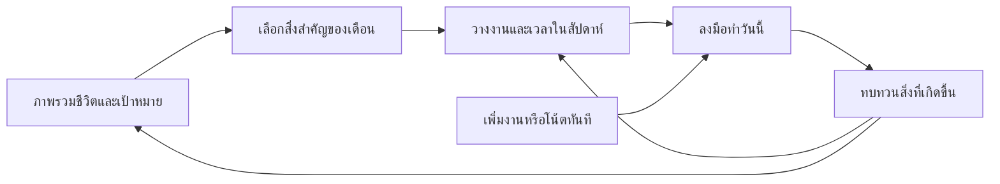

# Kemtit — แผนปรับ UX/UI สำหรับการวางแผนชีวิต

วันที่: 9 ตุลาคม 2026

สถานะ: ผู้ใช้สั่งให้ดำเนินการทุกเฟสในโปรเจกต์หลักแล้ว กำลังพัฒนาและตรวจสอบแอปจริงที่ localhost:3000 ติดตามผลที่ตรวจจริงและสิ่งที่ยังเหลือใน [บันทึกส่งมอบ](../qa/life-planner-delivery-2026-10-09/DELIVERY.md) ต้นแบบเป็นหลักฐานการออกแบบ ไม่ใช่หลักฐานว่าฟังก์ชันในแอปจริงเสร็จแล้ว

ผลส่งมอบระยะ 0 รอบแรก: [ต้นแบบและวิธีเปิด](../prototypes/life-planner-review/README.md), [หลักฐานและข้อจำกัด QA](../prototypes/life-planner-review/QA.md) ครอบคลุม 5 หน้า การ์ด/ภาพ/เวลา/กลุ่ม/ตัวช่วย 3 ขั้น ตรวจ layout 1440/768/390/360px และพฤติกรรมหลักในเบราว์เซอร์ ยังต้องพิจารณาต้นแบบ ทดสอบผู้ใช้ และตรวจ touch บนอุปกรณ์จริงก่อนปิดระยะ 0

ขอบเขตเพิ่มเติมจากผู้ใช้: รวมการ์ด Task, Drag & Drop ลงปฏิทิน, วันเวลาอัปเดตตามการย้าย, อัปโหลดรูปพร้อมภาพแรกเป็นปก, มือถือ/tablet/iPad/desktop, การลากการ์ดเข้าหากันสร้างกลุ่ม และ UX research ตามหัวข้อ 6.1–6.2 และระยะ 2

อ่านร่วมกับ [การวิเคราะห์ภาพอ้างอิง](2026-10-09-ui-ux-reference-analysis.md) และ [แผน UI เดิม](../Kemtit_UI_Optimization_Implementation_Plan.md) เอกสารนี้จัดลำดับงานจากคำขอล่าสุด ไม่ประกาศว่า batch เดิมเสร็จแล้วหรือยกเลิกข้อกำหนดเดิม

ข้อกำหนดล่าสุดจากผู้ใช้: **ห้ามคัดลอกงานออกแบบจากภาพอ้างอิง** ใช้เฉพาะการวิเคราะห์ปัญหาและหลักการใช้งาน ออกแบบโครงหน้า องค์ประกอบ และข้อความของ Kemtit ขึ้นเอง ไม่ทำสำเนาหรือเพียงเปลี่ยนสี/ชื่อ ไม่นำภาพประกอบ ไอคอน โลโก้ หรือ asset ของต้นแบบเข้าแอป

ภาพชุดใหม่ 9 ภาพเรียกว่า B1–B9 ในเอกสารวิเคราะห์ ข้อเสนอเพิ่มเติมอยู่หัวข้อ 6.3 และเชื่อมกับระยะส่งมอบเดิม โดยคง F1–F7 ในหัวข้อ 6.2 ครบ

## 1. ประสบการณ์ที่ต้องการ

ผู้ใช้ควรตอบได้โดยไม่ต้องเรียนรู้ระบบก่อนว่า:

1. ช่วงนี้ฉันกำลังให้ความสำคัญกับอะไร?
2. สิ่งที่จะทำในสัปดาห์นี้ช่วยเรื่องนั้นอย่างไร?
3. วันนี้ทำอะไรได้จริงภายใต้เวลาที่มี?
4. ถ้าทำไม่ทัน ฉันปรับแผนตรงไหนได้บ้าง?

หลักการ: เริ่มเล็ก เห็นความเชื่อมโยง และแก้แผนได้ ผู้ใช้ไม่จำเป็นต้องกำหนดเป้าทั้งปีครบทุกด้านก่อนเพิ่มงานแรก

แยกสองจังหวะการใช้งาน:

- **คิดและเลือก:** ดูภาพรวม ตั้งเป้าหมาย วางสัปดาห์ ทบทวน ใช้คำถามนำทางได้
- **ลงมือทำ:** เพิ่มงาน ดูนัด ทำเครื่องหมายเสร็จ เปิดแล้วทำได้ทันที

Wizard ควรลดความยากในการคิด ไม่เพิ่มขั้นตอนให้กิจกรรมที่ผู้ใช้รู้แล้วว่าต้องการทำอะไร

## 2. หลักฐานและความมั่นใจ

### สิ่งที่ตรวจแล้ว

- ในบทสนทนานี้ตรวจ Today, Plan, Calendar ใน Chrome ด้วยบัญชีใหม่บทบาทผู้ขาย ข้อมูลว่าง และ desktop
- Today มีสรุป 4 กล่องและเนื้อหา 3 คอลัมน์ รวมฟอร์มจัดเวลา คู่มือ และคำแนะนำหลายทาง
- Plan มีชุดเลือกช่วงเวลาสองตำแหน่งและคู่มือขนาดใหญ่ก่อนเนื้อหาแผน
- Calendar week มีสถานะไม่มีงานซ้ำในแต่ละวันและส่วนสรุปด้านล่าง
- ตรวจ source ปัจจุบัน: DailyPlanForm/schema รองรับงานสำคัญสูงสุด 3 รายการ, available minutes และ notes
- มี time blocks, availability/capacity, task planned_date/deadline, recurring occurrences และ weekly review/carry-over อยู่แล้ว
- calculateCapacity ใช้ 30 นาทีเมื่องานไม่มี estimated_minutes; เป็นค่าประมาณ ไม่ใช่เวลาที่วัดจริง
- ReviewsPage แสดง task/habit completion และ planned time; ยังไม่มีหลักฐานจากไฟล์ที่ตรวจว่ามีการจับเวลาใช้จริงหรือ baseline แผนต้นสัปดาห์
- getRangeTasks เลือกงานเดี่ยวจาก due_date และงานซ้ำจาก occurrence/scheduled date จึงต้องตามสัญญา planned_date/due_date/deadline ให้ครบก่อนเพิ่มการย้ายการ์ด ไม่สรุปว่าเป็น bug จาก query เดียว

### สิ่งที่ยังเป็นสมมติฐาน

- ลำดับข้อมูลใหม่จะช่วยให้ตัดสินใจเร็วขึ้น
- ภาพรวมที่เลือกแสดงเฉพาะด้านชีวิตสำคัญจะอ่านง่ายกว่าการแสดงทุกด้าน
- Wizard 3 ขั้นช่วยผู้ใช้ใหม่โดยไม่ทำให้ผู้ใช้ประจำเสียเวลา
- สัดส่วนงาน/ตารางเวลา 60/40 เหมาะกับ desktop ต้องพิสูจน์ด้วย mockup และข้อมูลจริงหลายระดับ

ยังไม่มี usability study หรือ responsive QA สำหรับข้อเสนอนี้ ห้ามนำผล QA เดิมมาเรียกว่าแผนใหม่นี้ผ่านแล้ว

## 3. กรณีใช้งานที่ต้องออกแบบให้ครบ

| สถานการณ์ | สิ่งที่ผู้ใช้ต้องการ | หน้าหรือพฤติกรรมที่เสนอ |
| --- | --- | --- |
| ยังไม่รู้เป้าหมายชัด | เริ่มจากเรื่องที่อยากให้ดีขึ้นโดยไม่ต้องกรอกตัวชี้วัดทันที | เพิ่มงานแรกได้ หรือเลือกตัวช่วยตั้งเป้าหมายหนึ่งเรื่อง |
| มีหลายเป้าหมาย | เลือกว่าจะให้เวลากับอะไรช่วงนี้ | ภาพรวมด้านชีวิตและเป้าหมายที่กำลังโฟกัส; ไม่บังคับน้ำหนักเท่ากัน |
| มีนัดแน่น | รู้ว่างานใหม่ใส่ตรงไหนได้ | แยกนัดตายตัว งานยังไม่จัดเวลา และเวลาประมาณที่เหลือ |
| เปิดแอประหว่างวัน | บันทึกหรือทำงานต่ออย่างรวดเร็ว | Today + Quick Capture โดยไม่มี wizard บังคับ |
| ทำตามแผนไม่ทัน | เลือกว่าจะเลื่อน ลด หรือพักอะไร | ทบทวนรายการและผลกระทบก่อนเปลี่ยน พร้อม Undo ตามสัญญาเดิม |
| ไม่ได้เปิดหลายวัน | กลับมาเริ่มได้โดยไม่ถูกงานค้างท่วม | สรุปสิ่งที่ยังเกี่ยวข้องและทางเลือกจัดการ ไม่ย้ายทั้งหมดให้อัตโนมัติ |

## 4. ภาพรวมที่มีประโยชน์: แสดงการตัดสินใจ ไม่ใช่ทุกข้อมูล

### ระดับ A — ทิศทางชีวิต

อยู่ใน Plan มุมมองปีเป็นจุดเริ่มต้น ไม่เพิ่มเมนูหลักใหม่ทันที

- แสดงด้านชีวิตที่ผู้ใช้เลือกโฟกัส เช่น งาน สุขภาพ การเงิน ครอบครัว พัฒนาตัวเอง ความสัมพันธ์ ตามหมวดที่ระบบรองรับ
- แต่ละด้านแสดงเป้าหมายที่กำลังทำ ความคืบหน้าตามหน่วยของเป้าหมายนั้น และขั้นตอนถัดไป
- ด้านที่ยังไม่เลือกแสดงเป็นทางเพิ่มแบบย่อ ไม่ตีความว่าแย่หรือมีคะแนนศูนย์
- ความคืบหน้าการเงิน กิจวัตร และงานใช้หน่วยต่างกัน ไม่เฉลี่ยเป็นคะแนนชีวิตเดียว
- เป้าที่ยังวัดไม่ได้ใช้ความคืบหน้าที่ข้อมูลรองรับ เช่น หมุดหมาย/งานที่เชื่อม ห้ามแสดงเปอร์เซ็นต์สมมติ

### ระดับ B — เดือนและสัปดาห์

- เดือน: เป้าหมายที่ต้องการขยับในเดือนนี้ พร้อมหลักฐานว่าจะทำอะไรต่อ
- สัปดาห์: ผลลัพธ์สำคัญที่เลือกไว้ + งานตามวัน + นัดที่เป็นข้อจำกัด + สิ่งที่ยังไม่ลงวัน
- มีลิงก์กลับไปยังเป้าหมายต้นทางโดยไม่ต้องเปิดหลายหน้า
- ไม่บังคับสร้างเป้าหมายซ้ำทุกระดับ: ผู้ใช้เริ่มจากงานรายวันหรือเป้าสัปดาห์ได้

### ระดับ C — วันนี้

- งานสำคัญสูงสุด 3 รายการ, งานวันนี้, นัดถัดไป และทางจัดเวลา
- มีป้ายเป้าหมายที่เชื่อมแบบย่อ สำหรับตอบว่าทำสิ่งนี้ไปเพื่ออะไร
- กิจวัตรและโน้ตอยู่รองลงมา; การเงินหรือข้อควรใส่ใจแสดงเด่นตามข้อมูลที่เกี่ยวกับวันนี้
- ไม่มีข้อมูล: ทางเริ่มต้นหลักหนึ่งทาง และทางเลือกตั้งเป้าหมายรอง ไม่ต้องแสดง dashboard ว่างหลายกล่อง



ลูกศรแสดงทางเชื่อมให้เลือกใช้ ไม่ใช่ขั้นตอนบังคับที่ทุกคนต้องผ่าน

## 5. Wizard ควรมีแค่ไหน

| งาน | รูปแบบที่เสนอ | ขอบเขต |
| --- | --- | --- |
| เริ่มใช้ครั้งแรก | ไม่เกิน 3 ขั้นหลัก พร้อมทางเริ่มแบบว่าง | ยังไม่เพิ่มจำนวนขั้นจาก onboarding ปัจจุบัน ต้องรักษาบทบาท/โฟกัส/data origin และการยืนยัน |
| ตั้งเป้าหมายเมื่อยังคิดไม่ออก | ตัวช่วย 3 ขั้นแบบเลือกใช้ | อยากเห็นอะไรดีขึ้น → ก้าวแรก/ช่วงเวลาที่พอทำได้ → ตรวจรายการที่จะสร้าง |
| ผู้ใช้ที่รู้เป้าหมายแล้ว | ฟอร์มสั้นหน้าเดียว | ไม่ต้องผ่านคำถามนำทางซ้ำ |
| วางสัปดาห์ | พื้นที่เดียว 3 ส่วน หรือโหมดแนะนำแบบเปิดใช้เอง | เลือกสิ่งสำคัญ → ดูเวลาที่มี → จัดและตรวจแผน |
| เพิ่ม/แก้งานประจำวัน | 0 ขั้น wizard | กรอกชื่อและบริบทที่จำเป็น แล้วบันทึก; รายละเอียดขั้นสูงเปิดเพิ่ม |
| ปรับแผนเมื่อไม่ทัน | ตัวช่วยตามคำขอ ไม่เด้งเอง | เลือกรายการ → ตรวจผลกระทบและยืนยัน; จำนวนหน้าขึ้นกับความซับซ้อน |
| ทบทวนสัปดาห์ | หน้าเดียว 3 คำถาม; มีโหมดนำทางได้ภายหลัง | อะไรคืบหน้า / อะไรติดขัด / สัปดาห์หน้าจะเปลี่ยนอะไร |

### ลักษณะหน้าจอ

- Desktop: กรอบเนื้อหาประมาณ 640–720px เป็นจุดเริ่มทดลอง ไม่ขยายฟอร์มเต็มความกว้างหน้าจอ
- Mobile: หน้าเต็มที่อ่านง่าย ไม่ซ้อน modal หลายชั้น; ปุ่มล่างต้องไม่ถูกคีย์บอร์ดบัง
- หนึ่งขั้นมีหนึ่งการตัดสินใจหลัก รวมช่องสั้นที่สัมพันธ์กันได้ ไม่ทำหนึ่งหน้าต่อหนึ่งช่อง
- บอกขั้นปัจจุบันและสิ่งที่จะเกิดขึ้นต่อ กลับไปแก้ได้โดยคำตอบไม่หาย
- ข้ามได้เฉพาะข้อมูลเสริม; แสดงข้อความผิดพลาดข้างข้อมูลที่ต้องแก้และพา focus ไปถูกจุด
- สรุปก่อนยืนยันอย่างเป็นรูปธรรม เช่น เป้าหมาย 1 รายการ งาน 2 รายการ และยังไม่ได้จองเวลา
- การปิด/กลับต้องไม่ทำให้เกิดข้อมูลจริงครึ่งชุด; หากต้องการบันทึกร่างข้ามอุปกรณ์ให้กำหนด persistence แยก ไม่อ้างว่า UI อย่างเดียวรองรับ
- การสร้างหลายรายการต้องออกแบบผลสำเร็จบางส่วน การลองใหม่ และการป้องกันซ้ำก่อนลงมือเขียน

เป้าหมายทดลอง: เริ่มต้นบัญชีใหม่ได้ราว 2–3 นาที แต่ยังไม่ใช่ผลทดสอบหรือข้อบังคับให้รีบตอบ

## 6. โครงหน้าและการโต้ตอบ

### Today

- หัวหน้ากระชับ: วันนี้ + วันที่ + เพิ่ม
- แถวสรุปสั้น: งานที่ทำแล้ว นัดถัดไป และเวลาโดยอธิบายว่าเป็นค่าที่ตั้ง/ประมาณ
- Desktop: งานเป็นพื้นที่หลักและตารางเวลาอยู่ข้างกัน; ต่ำกว่าความกว้างที่ชื่อเริ่มอึดอัดให้ซ้อน
- ส่วนงานสำคัญเป็นการแสดง/ปรับ daily plan เดิม ไม่สร้างรายการงานอีกชุด
- จัดเวลาเปิดเมื่อกด; เมื่อตารางว่างไม่แสดงฟอร์มยาวค้างอยู่
- หน้าจอมีพื้นที่ให้พักสายตา แต่ไม่ใช้การ์ดใหญ่เพื่อแสดงเพียงเครื่องหมายขีด

### Plan

- มีหัวควบคุมปี/เดือน/สัปดาห์และเลือกช่วงเวลาเพียงชุดเดียว
- ปี: ภาพรวมด้านชีวิตและเป้าหมาย; เดือน: ผลลัพธ์และงานเชื่อม; สัปดาห์: สิ่งสำคัญกับการลงมือทำ
- แนวทางใช้งานเป็นคำแนะนำสั้นตามบริบท เปิดอ่านต่อได้
- Desktop week ใช้รายการตามวันหรือคอลัมน์เมื่ออ่านชื่อได้; tablet/mobile ใช้แถบเลือกวัน + รายการ ไม่ย่อ 7 คอลัมน์ให้เล็กลง
- เสาร์และอาทิตย์ยังเป็นวันแยกกัน มีตัวเลือกแสดงครบทุกวัน

### Calendar

- ตอบว่าเวลาอยู่ตรงไหน: วัน/สัปดาห์/เดือน และนัดหมาย/ช่วงเวลางานจากข้อมูลที่มี
- งานยังไม่มีเวลาอยู่ในพื้นที่แยก; บิลหรือวันครบกำหนดไม่กินพื้นที่ชั่วโมงจนกว่าจะมีช่วงเวลาจริง
- รุ่นแรกมีทั้ง Drag & Drop และปุ่มเลือกวัน/จัดเวลา โดยใช้กฎการบันทึกชุดเดียวกัน
- การลาก/ย้ายต้องบอกว่าเปลี่ยนวันวางแผนหรือช่วงเวลา โดยไม่เปลี่ยนกำหนดส่งเงียบ ๆ; รองรับ keyboard และปุ่มทำงานเดียวกัน

### Review / Insights

- สรุปสิ่งที่ทำได้ก่อนชวนปรับสัปดาห์หน้า
- แสดงนิยามตัวเลข เช่น งานในช่วงนี้ที่เสร็จ ไม่ตั้งชื่อว่าแผนต้นสัปดาห์หากไม่มี snapshot รองรับ
- เวลาใน time block คือเวลาที่จัดไว้ ไม่ใช่เวลาที่ใช้จริง
- เสนอ carry-over ตามตัวเลือกผู้ใช้ รักษากำหนดส่งและแสดงกรณีขัดแย้ง
- ความคืบหน้าชีวิตไม่วัดจากจำนวน task อย่างเดียว ใช้ผลลัพธ์เป้าหมายและข้อมูลที่ผู้ใช้บันทึกควบคู่กัน

## 6.1 Drag & Drop — รวมในรุ่นแรกตามคำขอผู้ใช้

### การลากต้องมีความหมายเดียวและเห็นผลก่อนปล่อย

| การกระทำ | ผลที่ผู้ใช้คาดหวัง | สัญญาข้อมูลที่ต้องรักษา |
| --- | --- | --- |
| ลากงานจากวันจันทร์ไปอังคารในแผนสัปดาห์ | เปลี่ยนวันที่ตั้งใจทำ | งานเดิม ID เดิม; รักษา deadline; ตรวจ mapping ของ due_date/planned_date และ linked block |
| ลากงานที่ยังไม่จัดเวลาลงช่อง 10:00 | จองช่วงเวลาสำหรับงานนี้ | สร้าง time block ที่เชื่อมงานเดิม ไม่สร้าง task/event ซ้ำ; บอกระยะเวลาก่อนปล่อย |
| ลากช่วงเวลางาน 10:00 ไป 14:00 | เปลี่ยนเวลาเริ่มโดยคงระยะเวลา | ตรวจ version, timezone, วันของ linked task/occurrence และเวลาทับซ้อน |
| ลากขอบล่างของช่วงเวลางาน | ปรับเวลาจบ | เปลี่ยนเวลาที่จอง ไม่เปลี่ยน estimated_minutes หรือเวลาใช้จริงโดยอัตโนมัติ |
| ลากงานเข้า/เรียงในสิ่งสำคัญวันนี้ | เลือกและจัดลำดับงานสำคัญ | ใช้ daily plan เดิม สูงสุด 3 รายการ; ถ้าเต็มต้องให้ผู้ใช้เลือกแทนที่ ไม่ทิ้งรายการเก่าเงียบ ๆ |

การจัดลำดับงานทั้งหมดแบบอิสระในทุกหน้าไม่รวมอัตโนมัติกับการเรียงสิ่งสำคัญ 3 รายการ ต้องตรวจว่ามีตำแหน่งที่บันทึกถาวรและกฎการเรียงเมื่อเปิด filter อยู่ก่อนเพิ่ม scope

### ประสบการณ์การลาก

1. เห็นจุดจับลากที่ชัดเจนและยังแตะชื่อเพื่อเปิดรายละเอียดได้
2. ขณะลากแสดงเงารายการ ตำแหน่งที่จะวาง วัน/เวลาใหม่ และปลายทางที่รับได้
3. ช่องที่รับไม่ได้แสดงเหตุผลเป็นข้อความ ไม่ใช้สีเพียงอย่างเดียว
4. การย้ายทั่วไป: ปล่อยแล้วบันทึก พร้อมสถานะกำลังบันทึก/บันทึกแล้ว และปุ่มย้อนกลับ โดยไม่เปิด wizard หรือ modal ทุกครั้ง
5. ถ้าขัดกับ deadline, สิทธิ์, ข้อมูลที่เปลี่ยนในอีกแท็บ หรือข้อจำกัดงานซ้ำ ให้หยุดและอธิบายก่อนเขียน ใช้ validation เดิม ไม่มีการเปลี่ยน deadline หรือเลื่อนนัดอื่นเพื่อให้วางได้
6. ถ้าเครือข่ายล้มเหลว แสดงสถานะที่ตรงกับผลจริง กรณีไม่ทราบว่าสำเร็จหรือไม่ต้อง readback/ใช้ operation เดิม ไม่ยิงคำขอสร้างใหม่ทันที
7. กด Escape หรือปล่อยนอกปลายทางที่รองรับเพื่อยกเลิก โดยไม่มีการบันทึก

งานที่มีช่วงเวลาเชื่อมหลายรายการต้องแสดงว่าจะกระทบอะไรและตรวจทุกช่วงก่อนย้าย การลากงานซ้ำในรุ่นแรกหมายถึงเฉพาะ occurrence ที่เลือก ไม่ขยายเป็นทั้งชุด

### ปฏิทินและมือถือ

- เสนอ snap ทุก 15 นาทีเป็นค่าเริ่มทดลองสำหรับการลาก; การกรอกเวลาเองยังใช้ความละเอียดเดิมได้ และการเปิดดูไม่ปัดเวลาเดิมทิ้ง
- การเลื่อน block ต้องรักษาระยะเวลาเดิม การ resize เปลี่ยนระยะเวลาที่จองอย่างชัดเจน
- งานไม่มีระยะเวลาใช้ค่าเริ่มต้นที่แสดงให้เห็น เช่น 30 นาที พร้อมทางแก้ ไม่จองเต็มวัน
- แยกพื้นที่งานยังไม่จัดเวลา/รายการทั้งวันออกจากช่องชั่วโมง
- รุ่นแรกเน้นงานและ time block ของผู้ใช้ใน Kemtit; นัดหมายจากบริการภายนอกและรายการที่แก้ไม่ได้ไม่มีจุดจับลากจนกว่าจะยืนยันสิทธิ์และสัญญา sync
- บนมือถือเลื่อนหน้าได้ตามปกติ ใช้การกดค้างที่จุดจับเพื่อเริ่มลาก พร้อมปุ่ม “ย้ายไปวัน…” และ “จัดเวลา…” ที่มองเห็น
- มุมมองวันบนมือถือมีแถบวันที่ให้เลือกเป็นปลายทางได้; ไม่บังคับลากข้าม 7 คอลัมน์แคบ ๆ หรือข้ามหน้าจอที่มองไม่เห็น
- Desktop มี auto-scroll ใกล้ขอบอย่างควบคุมได้; keyboard เลือกต้นทาง/ปลายทาง ยืนยันหรือยกเลิกได้ พร้อมประกาศสถานะให้ screen reader

### ขอบเขตการบันทึกและ QA

- ไม่เขียนข้อมูลระหว่าง pointer move/hover; บันทึกเมื่อ drop ที่ผ่าน validation หรือเมื่อยืนยันกรณีที่มีผลกระทบเพิ่มเติม
- ใช้ server authorization และข้อมูล version ปัจจุบัน; operation เดียวต้องไม่สร้างข้อมูลซ้ำจาก double drop, lost response หรือ retry
- การเปลี่ยนหลายรายการที่ต้องสำเร็จร่วมกันต้องเป็น atomic operation หรือมีวิธีรักษาความสอดคล้องที่ตรวจได้
- Undo เป็นการย้อน operation ที่ตรวจ version/ownership ไม่เขียนทับการแก้ใหม่จากอีกแท็บ; ต้องออกแบบเพิ่มเฉพาะ action ที่ปัจจุบันยังไม่มี Undo
- Reload และเปิดจากอีกหน้าต้องได้วัน เวลา ลำดับ และสถานะเดียวกัน ไม่จำกัดอยู่ใน state ของ browser
- ทดสอบ drag แล้วเปิดรายละเอียด, ยกเลิก, wrong drop target, วันข้ามเดือน/ปี, recurring occurrence, มี block เชื่อม, สิ่งสำคัญครบ 3, งานเสร็จ/เก็บในคลัง, overlap, deadline conflict, concurrent edit, lost response, retry และ Undo
- ทดสอบ mouse/touch/keyboard, TH/EN, 1440/768/390/360px และชื่อรายการยาวบน Chrome
- Mockup ต้องมีทั้งก่อนลาก/ขณะลาก/สำเร็จ/วางไม่ได้/บันทึกล้มเหลว มิใช่แค่ภาพการ์ดนิ่ง
- เลือกเทคโนโลยี Drag & Drop หลังตรวจ dependency เดิมและความสามารถด้าน touch/keyboard; ยังไม่เลือกหรือติดตั้งไลบรารีจากเอกสารนี้

### ผลตรวจสัญญาปัจจุบันเพิ่มเติมสำหรับ Drag & Drop

ตรวจแบบ read-only ด้วย graph และ source โดย advisor แยกจากผู้เขียนแผน:

- **ความเสี่ยง CRITICAL:** impact ของ `rescheduleTask` และ `rescheduleTaskOccurrence` รายงาน 10 upstream symbols, 7 page flows และ 6 modules ครอบคลุม Today/Plan/Calendar/Goal/Project/widgets ต้องวิเคราะห์ใหม่จาก checkout จริงก่อนแก้และทดสอบข้ามหน้า ไม่ถือเป็นงานตกแต่ง UI อย่างเดียว
- `rescheduleTask` ปัจจุบันย้ายทั้ง `planned_date` และ `due_date` พร้อมเลื่อน active linked blocks แบบ atomic โดยรักษา `deadline` ต้องคง/ระบุความหมายของ due_date แบบเดิมให้ชัด ถ้าจะเปลี่ยนเป็น planned-only ต้องแก้ query/contract ที่เกี่ยวข้องด้วย
- การย้ายข้ามวันยังไม่ได้รับประกันว่าจะปฏิเสธวันหลัง deadline ทุกเส้นทาง ข้อกำหนดป้องกัน deadline conflict ในหัวข้อ 6.1 จึงเป็นงานที่ต้องเพิ่ม/ยืนยันฝั่ง server ก่อน release
- งานซ้ำต้องใช้ `rescheduleTaskOccurrence`; รักษา `occurrence_date` เป็นตัวตน และเปลี่ยน `scheduled_date` ของครั้งนั้น อาจมี occurrence เดิมของวันปลายทางอยู่ด้วย ต้องแยกแสดงและไม่รวมทิ้ง
- `daily_plans.top_priorities` เก็บลำดับได้และตัวจัดรายการใช้ลำดับนี้ แต่ยังไม่พบ position/sort_order สำหรับงานทั่วไป จึงจำกัดการเรียงอิสระไว้ที่สิ่งสำคัญสูงสุด 3 รายการ
- `saveDailyPlan` เป็น whole-row upsert ไม่มี expected version/operation ID/Undo สำหรับการลาก ต้องออกแบบ mutation ที่ไม่เขียนทับเวลา/โน้ต/การแก้จากอีกแท็บ
- `createTimeBlock` ผูกงานเดิมและตรวจ overlap ได้ แต่ยังไม่มี operation ID สำหรับ lost response/retry ที่ยืนยันผลเดิมได้ ห้ามใช้ client pending state แทนการป้องกันซ้ำฝั่ง server
- `updateTimeBlock` มี expectedVersion และตรวจ stale/locked/overlap อยู่แล้ว แต่ยังไม่มี operation ID และ Undo; การ resize เปลี่ยน block โดยไม่เปลี่ยน estimated_minutes
- การย้ายงานข้ามวันเลื่อน active linked blocks ทุกช่วงโดยรักษาระยะเวลา จึงต้อง preview หลายช่วงและตรวจ locked/anchor/overlap ไม่ย้ายเฉพาะการ์ดบนจอ
- Rescue มีรูปแบบ operation ID, before/after และ Undo ที่ตรวจ ownership/version อยู่แล้ว ใช้ศึกษาวิธีแก้แบบจำกัดขอบเขต ไม่สรุปว่าคำสั่งลากทุกชนิดมีคุณสมบัติเหล่านี้แล้ว

ลำดับงานย่อยภายในระยะ 2 ปรับตามคำขอทั้ง 7 ข้อเป็น (2A) การ์ดและภาพปก → (2B) วาง/ย้ายวันเวลา → (2C) กลุ่มการ์ด → (2D) ตรวจรวมทุกอุปกรณ์และ usability รายละเอียดในหัวข้อ 6.2 งานเรียงสิ่งสำคัญและ resize ยังอยู่ในขอบเขต โดยทุก action ต้องมี mutation/Undo ที่ปลอดภัย ปุ่ม และ keyboard ทำงานเดียวกันได้

จุดอ้างอิงที่ตรวจ: `src/core/tasks/actions.ts`, `src/core/planning/actions.ts`, `src/core/planning/workflow-suggestions.ts`, `src/core/domain/dayplan.ts` และ migrations `20260927100000_atomic_linked_task_reschedule.sql`, `20260927142000_active_counted_time_block_conflicts.sql`, `20260927142100_order_independent_rescue_blocks.sql`, `20260922122000_rescue_operations.sql` ต้องตรวจ source ปัจจุบันอีกครั้งเมื่อลงมือพัฒนา ไม่ใช้เอกสารนี้แทน impact check

## 6.2 การ์ดงาน ปฏิทิน และกลุ่มการ์ด — เพิ่มทั้ง 7 ข้อในรุ่นแรก

ข้อกำหนดฉบับละเอียดและเกณฑ์ตรวจรับ: [Task Cards, Calendar & Groups](2026-10-09-task-cards-calendar-groups.md) เป็นส่วนหนึ่งของแผนนี้ ใช้สัญญาวัน/เวลาและความปลอดภัยการบันทึกจาก 6.1 ร่วมกัน

| ID | ความสามารถ | ข้อกำหนดหลัก |
| --- | --- | --- |
| F1 | สร้างการ์ด Task | ฟอร์มสั้น ไม่มี wizard ใช้ Task ID เดิมร่วมกับทุกหน้า |
| F2 | ลากลงปฏิทิน | มีถาดการ์ดข้างปฏิทินบนจอกว้าง/ถาดล่างบนมือถือ เห็น preview ก่อนปล่อย |
| F3 | วันเวลาในการ์ด | วางแล้วบันทึก ย้ายแล้วอัปเดตการ์ด รายละเอียด และปฏิทินพร้อมกัน คง deadline และไม่สร้างงานซ้ำ |
| F4 | รูปและ cover | อัปโหลดได้ ภาพแรกตามลำดับที่บันทึกเป็นปก ไม่มีรูปใช้ title; มีรูปก็ยังแสดงชื่องาน |
| F5 | ทุกประเภทอุปกรณ์ | มือถือ tablet/iPad และ desktop พร้อม touch/mouse/keyboard และทางเลือกแตะโดยไม่ลาก |
| F6 | กลุ่มแบบ iPhone | ลาก A ทับ B ในพื้นที่การ์ดแล้วปล่อยสร้างกลุ่มทันที ตั้งชื่อ/เพิ่ม/นำออก/ยุบ/Undo ได้ โดยคงงานแต่ละใบ |
| F7 | Research และใช้ง่าย | ศึกษา Apple, Sunsama, W3C และภาพอ้างอิง พร้อมทดสอบต้นแบบกับผู้ใช้จริงก่อนอ้างว่าใช้ง่ายขึ้น |

การตัดสินใจเพื่อป้องกันความสับสน: พื้นที่การ์ดใช้รวมกลุ่ม ส่วนปฏิทินใช้จัดวันเวลา การลากทับ block ในปฏิทินจึงไม่สร้างกลุ่ม; งานในกลุ่มยังมีวันที่และเวลาของตัวเอง การลากทั้งกลุ่มไปจัดเวลาพร้อมกันแยกเป็นขอบเขตภายหลัง

ต้องส่งมอบฟีเจอร์เหล่านี้พร้อมพฤติกรรมบันทึกจริง ไม่ใช่การ์ดที่เคลื่อนได้เฉพาะใน browser หรือภาพ mockup; รอบนี้เพิ่มข้อกำหนดในแผน ยังไม่ได้พัฒนาแอป

## 6.3 ข้อเสนอเพิ่มเติมจากภาพชุด B — วันนี้ เส้นเวลา และกิจวัตร

แนวทาง: ทำให้ Kemtit อ่านภาพรวมวันได้เร็ว มีลำดับข้อมูลชัดและน้ำเสียงเป็นมิตร ใช้โครงหน้าและส่วนประกอบที่ออกแบบสำหรับงานของ Kemtit เอง รายละเอียดภาพทั้ง 9 ใบและแหล่ง research อยู่ใน [เอกสารวิเคราะห์ชุด B](2026-10-09-ui-ux-reference-analysis.md)

### ข้อเสนอและลำดับความสำคัญ

| ID | ปรับอะไร | ผู้ใช้ได้ประโยชน์อย่างไร | ระยะ |
| --- | --- | --- | --- |
| U1 | แถบเลือกสัปดาห์ + ปฏิทินเดือนย่อ/ขยาย | เปลี่ยนวันเร็วและข้ามเดือนได้ โดยรักษาวันที่เลือก | 1–2 |
| U2 | เส้นเวลาปัจจุบัน + รายการถัดไป + ช่องว่างในตาราง | เห็นลำดับของวันและช่วงที่ยังไม่ได้จอง | 1–2 |
| U3 | ตารางเวลาตามสเกลจริง / รายการเรียงเวลา และแผงแก้ไข | จัดเวลาด้วยการลาก แล้วอ่านรายละเอียดได้เต็มที่ | 2B |
| U4 | การ์ดย่อ/ขยายและงานย่อย | เห็นสิ่งที่ต้องทำโดยไม่เปิดหน้ารายละเอียดทุกครั้ง | 2 หลังตรวจสัญญา checklist |
| U5 | สรุปความคืบหน้าที่มีขอบเขต/ตัวหารชัด | เข้าใจว่างานสำเร็จ กิจวัตร และเวลาที่จัดไว้ต่างกัน | 1 สำหรับสรุปเดิม; 3 สำหรับ Review |
| U6 | ประวัติกิจวัตรช่วง 30 วัน + ทบทวนสั้น | มองความสม่ำเสมอจากบันทึกจริงและเลือกปรับแผน | ข้อเสนอระยะ 3 |
| U7 | ภาษาภาพเป็นมิตร อ่านง่าย และออกแบบเอง | ใช้ได้นานทั้งจอเล็ก/ใหญ่ โดยยังอ่านชื่อและคำสั่งได้ | ทุกระยะ |
| U8 | ชุดเริ่มต้นตามบริบทแบบเลือกใช้ | เริ่มจากชีวิต งาน หรือการเรียนได้โดยไม่ต้องกรอกทุกอย่าง | Discovery ระยะ 3; ไม่บังคับ onboarding เพิ่ม |

U1–U5/U7 เป็นรายละเอียดของโฟลว์เดิมและ F1–F7; U6/U8 เป็นข้อเสนอเพิ่มเติมที่ต้องประเมินข้อมูลและทดสอบต้นแบบก่อนรวมใน implementation batch ไม่เปลี่ยนให้รุ่นแรกต้องรอ Pomodoro, ระบบเรียน, challenge หรือชุดธีมใหม่

### U1–U3: ภาพรวมวันและปฏิทิน

- หน้า Today เริ่มจากวันที่ สิ่งสำคัญสูงสุด 3 รายการ และตารางวันนี้ สรุปเป็นแถวสั้น กราฟระยะยาวอยู่ Reviews/Insights ตามหน้าที่เดิม
- Calendar บนมือถือใช้แถบสัปดาห์และวันเดียวเป็นค่าเริ่มต้น กดหัววันที่เพื่อขยายเดือน เมื่อเลือกแล้วกลับสู่วันที่นั้นได้; เดือนเต็มไม่กินจอทุกครั้งที่เปิด
- แยก “วันนี้” กับ “วันที่เลือก” ด้วยข้อความและรูปทรงที่ต่างกัน เลือกวันอื่นแล้วหัวหน้าต้องบอกวันนั้น ไม่แสดงคำว่าวันนี้ผิดวัน มีปุ่มกลับวันนี้ และปุ่มก่อนหน้า/ถัดไป
- มุมมองวัน/สัปดาห์/เดือนใช้ selected date, view และ scope เดียวกันกับ URL เปลี่ยนมุมมองหรือกลับจากรายละเอียดแล้วไม่กระโดดไปวันอื่น ตัวกรองและตำแหน่งเลื่อนกลับได้ตามบริบท
- เส้น “ตอนนี้” แสดงเฉพาะคอลัมน์ของวันปัจจุบันตาม timezone ที่ระบบใช้ แสดงเวลาเป็นข้อความ เส้นไม่บังชื่อหรือปุ่ม และไม่แย่ง focus/อ่านเวลาออกเสียงทุกนาที
- ใช้คำว่า “ช่วงเวลานี้” เมื่อทราบเพียงตาราง ไม่อ้างว่าผู้ใช้กำลังทำงานนั้นอยู่จริง รายการถัดไปบอกชื่อและเวลา ส่วนเวลาว่างเรียก “ช่องว่างในตาราง” เมื่อยังไม่ทราบข้อจำกัดชีวิต/ปฏิทินภายนอกครบ
- การเข้าสู่วันปัจจุบันอาจเลื่อนไปช่วงตอนนี้ครั้งแรกตามที่ทดสอบ แต่ไม่เลื่อนหนีตำแหน่งที่ผู้ใช้กำลังอ่านหรือกำลังลากเมื่อเวลาผ่านไป
- Desktop Calendar: ถาดงาน/กลุ่มด้านซ้ายและตารางด้านขวา; mini calendar เป็นตัวเลือกย่อ/ขยายในถาดเดียว ไม่เพิ่ม sidebar ชั้นที่สาม แผงแก้ไขใช้พื้นที่ชั่วคราวเมื่อเลือกงาน
- ตัวกรองแยก “ประเภท/แหล่งรายการ” ออกจาก “กลุ่มงาน” มีชื่อชัดเจนและบอกว่าเปิดตัวกรองอยู่ ซ่อนรายการเพื่ออ่านง่ายไม่เท่ากับทำให้เวลานั้นว่าง การตรวจ overlap ต้องยังดูรายการที่เกี่ยวข้องแม้ซ่อนอยู่
- เลือกช่องว่างในตารางแล้ว “เพิ่มงาน” ใช้วันเวลาเริ่มนั้นเป็นค่าเสนอในฟอร์ม; ปุ่มเพิ่มทั่วไปเปิด Quick Capture เดิมตามสัญญา proposal/confirm ปุ่มเพิ่มในกลุ่มใช้กลุ่มเป็นค่าเสนอ ไม่บันทึกก่อนผู้ใช้ยืนยัน

สองรูปแบบแสดงข้อมูลเดียวกัน โดยรักษาวันเวลาและ Task ID:

| รูปแบบ | กฎการแสดง/การโต้ตอบ |
| --- | --- |
| ตารางเวลาตามสเกล | ตำแหน่งและความสูงอ้างเวลาเริ่ม–จบจริง เหมาะกับลาก/resize; ขยายรายละเอียดในแผงข้างหรือแผงล่าง ไม่ยืดบล็อกเวลาตามความยาว checklist/รูป |
| รายการเรียงเวลา | ความสูงตามเนื้อหา แสดงเวลาและระยะเวลาด้วยข้อความ ขยาย checklist ได้ ใช้ปุ่มจัดเวลา/ย้ายวัน; ไม่ตีความตำแหน่งแนวตั้งเป็นเวลาเมื่อไม่มีสเกล |

บล็อกสั้นมากต้องมีทางเลือกอ่านและแตะที่เข้าถึงได้ เช่น รายการเรียงเวลา/แผงรายละเอียด โดยไม่ขยายความสูงจนดูเหมือนจองเวลามากขึ้น งานทั้งวัน งานไม่มีเวลา และกำหนดส่งอยู่แยกจากช่องชั่วโมง รายการที่ทับซ้อนยังเห็นจำนวนและเปิดเลือกได้ ไม่วาดทับจนงานหาย

### U4: การ์ด กลุ่ม และ checklist

- การ์ดใหญ่ในถาดมีภาพปก/ชื่อ/วันเวลา ตาม F4 การ์ดบนตารางใช้ชื่อและเวลาเป็นหลัก ภาพเล็กเฉพาะเมื่อพื้นที่พอ; คลิกหรือแตะเปิดรายละเอียดได้ ไม่พึ่ง hover
- แผงรายละเอียด desktop เปิดข้าง และมือถือเปิดแผงล่าง/หน้าเดียวที่คีย์บอร์ดไม่บังปุ่ม คืน focus ที่การ์ดเดิมเมื่อปิด และคงตำแหน่งเลื่อน
- งานที่มี subtasks แสดงจำนวน เช่น “งานย่อยเสร็จ 2 จาก 4” และขยายตามบริบท การขยาย/ยุบไม่เขียนข้อมูล; toggle เขียนเฉพาะรายการที่เลือกและมีสถานะบันทึก
- Subtasks ปัจจุบันมี `task_id` กับ `completed_at` ชุดเดียว ไม่มีสถานะต่อ occurrence จึงใช้ inline editing กับงานเดี่ยวก่อน งานซ้ำให้แสดงป้ายว่าเป็นรายการย่อยร่วมทั้งชุดและเปิดรายละเอียดเดิม ไม่ทำให้ดูเหมือนรีเซ็ต checklist ทุกวัน
- **โฟลเดอร์ F6** รวม Task หลายใบเพื่อจัดหมวด; **subtask** เป็นขั้นตอนของ Task ใบหนึ่ง; **Habit** มีบันทึกตามวันที่ ทั้งสามอย่างต้องมีป้าย/คำสั่งตรงชนิด และไม่เปลี่ยนชนิดข้อมูลเมื่อเปิดดูหรือรวมกลุ่ม
- ภาพ routine เช่น Post Workout ใช้ศึกษาแนวคิดเปิดรายการย่อย “ชุดกิจวัตรเช้า” ที่รวมหลาย Habit และสร้างช่วงเวลาพร้อมกันเป็นงานออกแบบเพิ่มเติมในระยะ 3 ไม่อ้างว่าโฟลเดอร์ F6 ทำหน้าที่นี้แล้ว
- การทำเครื่องหมายงานเสร็จใน Calendar ต้องใช้ Task หรือ occurrence ที่เลือกตามสัญญาเดิม เส้นเวลาผ่านปลาย block, ปิดรายละเอียด หรือทำ subtask ครบ ไม่ใช่คำสั่งทำงานหลักเสร็จโดยอัตโนมัติ
- งานเสร็จใช้เครื่องหมายและข้อความร่วมกัน ขีดฆ่าเฉพาะชื่ออย่างพอดี ไม่ลดความชัดของเวลา/คำสั่งจนอ่านไม่ได้ กลุ่มยังคงเป็นสมาชิกเดิม

### U5: ความคืบหน้าที่อธิบายได้

| ข้อมูล | คำที่ควรแสดง | เงื่อนไข |
| --- | --- | --- |
| งาน | “งานในรายการนี้เสร็จ 3 จาก 7” หรือชื่อช่วงที่ query รองรับ | ใช้ numerator/denominator จากขอบเขตเดียวกัน ระบุว่ารวมงานค้าง/งานซ้ำหรือไม่ แยก Task ออกจากจำนวน time blocks |
| กิจวัตรรายสัปดาห์ | “สัปดาห์นี้ทำ 2 ครั้ง จากเป้า 3 ครั้ง” | ใช้ completion จริงและ target_per_week ไม่แปลว่าอีก 5 วันทำพลาด |
| ช่วงเวลางาน | “จัดเวลาไว้ 2 ชม. 30 นาที” | นับ active blocks ตามนิยามที่ตรวจแล้ว ไม่เรียกว่าเวลาที่ใช้จริงหรือ Focus Time |
| เป้าหมาย | คืบหน้าตามหน่วย/หมุดหมายของเป้าหมายนั้น | ไม่ใช้สัดส่วนจำนวนงานแทนผลลัพธ์ทุกชนิด และไม่เฉลี่ยเป็นคะแนนชีวิตเดียว |

- ไม่มีตัวหารหรือยังไม่มีรายการให้ใช้ข้อความ “ยังไม่มีรายการในช่วงนี้” แทนเปอร์เซ็นต์ที่ไม่มีความหมาย ข้อมูลโหลดไม่สำเร็จแสดง error ไม่ปลอมเป็นศูนย์
- สรุปจำนวนต้องนับ canonical item ครั้งเดียว แม้งานเดียวปรากฏทั้งถาด กลุ่ม และปฏิทิน; งานซ้ำนับตาม occurrence ที่อยู่ในขอบเขตนั้นและไม่รวมครั้งที่เลื่อนมาวันเดียวกันทิ้ง
- ก่อนใช้ตัวเลขข้ามหน้าให้ตรวจ query เดิม: weekly task rate ปัจจุบันนับ non-recurring tasks ที่ due ในสัปดาห์ จึงไม่เปลี่ยนป้ายให้หมายถึงทุกงานใน Today โดยไม่ปรับสัญญา
- กราฟระยะยาวบอกช่วงเวลา หน่วย และชุดข้อมูลให้ชัด ถ้าตัวหารเปลี่ยนเพราะเพิ่ม/เลื่อนงานให้สะท้อนขอบเขตปัจจุบัน ไม่อ้างเป็นแผนต้นสัปดาห์ถ้าไม่มี baseline

### U6/U8: กิจวัตร 30 วัน การทบทวน และชุดเริ่มต้น

- เสนอหน้า Life/Reviews แสดงบันทึกกิจวัตรช่วง 30 วัน พร้อมวันที่เริ่ม–สิ้นสุด; แยกจากมุมมองเดือนที่อาจมี 28–31 วัน ไม่เพิ่มเมนูหลักใหม่ทันที
- Desktop แสดง matrix ได้เมื่ออ่านง่าย; มือถือให้รายการกิจวัตรและแถบวันแบบย่อ เปิดดูย้อนหลังได้โดยไม่ย่อ 30 ช่องให้แตะไม่ได้
- Habit เดิมมี daily/weekly cadence และ target_per_week พร้อม completion ต่อวัน ยังไม่มีตารางวันในสัปดาห์หรือสถานะ missed/skipped จึงแสดง “มีบันทึกว่าทำแล้ว” และ “ไม่มีบันทึก” อย่างตรงข้อมูล วันอนาคตเป็นกลาง
- แสดงผลเทียบเป้ารายสัปดาห์ตามกติกาปัจจุบัน ไม่สรุปว่าวันใดพลาดจาก target_per_week เพียงอย่างเดียว และไม่ reset ประวัติเมื่อผู้ใช้ขาดช่วง
- “Challenge 30 วัน” ที่มีเริ่ม/จบ กติกา ข้อยกเว้น และสถานะสำเร็จ ต้องนิยามสัญญาใหม่แยกจากการดูประวัติ 30 วัน ก่อนเพิ่มขอบเขตพัฒนา
- ทบทวนสั้นใช้ Reviews/Note เดิม: อะไรคืบหน้า → อะไรติดขัด → จะปรับอะไรต่อ พร้อมเชื่อมไปปรับแผน ไม่สร้างสมุดอีกชุดอัตโนมัติ
- ชุดเริ่มต้นชีวิต/งาน/เรียนเป็นตัวเลือกสมัครใจ ใช้ Goal/Project/Task/Habit/Note ที่เหมาะกับชนิดข้อมูลนั้น ตรวจรายการที่จะสร้างก่อนยืนยัน และป้องกันการสร้างซ้ำ ไม่เปลี่ยนชื่อ Project เป็นวิชาให้ทุกบัญชี
- คง wizard ตั้งเป้าหมายแบบเลือกใช้ไม่เกิน 3 ขั้นตามหัวข้อ 5; งานประจำวันยังเพิ่มได้ทันที การเลือกรูปแบบหน้าจอไม่สร้างข้อมูลจริง
- Pomodoro, actual focus sessions, ระบบวิชา/ข้อสอบเฉพาะทาง, ตัวชี้วัดร่างกาย และ before/after photos อยู่ในรายการ discovery แยก ไม่เพิ่มจากภาพเพียงอย่างเดียว

### U7: ภาษาภาพและข้อกำหนดการออกแบบเอง

- คงแบรนด์ม่วงของ Kemtit บนพื้นผิวกลางอ่อน ใช้สีอ่อนช่วยจำแนกอย่างจำกัด ตัวอักษรเข้มและชื่อการกระทำชัดเจน
- ออกแบบ hierarchy, spacing, typography, card anatomy, microcopy และส่วนประกอบภาพจากงานของ Kemtit โดยใช้ design tokens เดิมเท่าที่เหมาะสม ตรวจที่มา asset ที่นำมาใช้จริง
- ความเป็นมิตรเกิดจากคำแนะนำสั้นและทางเริ่มที่ชัด เช่น “เพิ่มงานแรก” หรือ “เลือกเวลาที่สะดวก” ภาพตกแต่งเป็นตัวเลือกและไม่ดันงานหลักออกจากจอ
- รักษากฎเดิมไม่ใช้แถบสีตกแต่งซ้ายการ์ด ไม่สร้างทุกการ์ดเป็นคนละสีแรง ไม่ใช้ layout/ตัวละคร/สติกเกอร์/โลโก้/ข้อความจากภาพอ้างอิงมาตัดใช้หรือ trace
- วัด contrast จริงตาม [W3C Contrast](https://www.w3.org/WAI/WCAG22/Understanding/contrast-minimum.html); ใช้ข้อความ/ไอคอนประกอบสีตาม [Use of Color](https://www.w3.org/WAI/WCAG22/Understanding/use-of-color.html)
- ทดลอง body ประมาณ 16px และปุ่มสัมผัสหลักประมาณ 44px โดยรักษา readability ของไทย; แยกเป้าหมายออกแบบนี้จากเกณฑ์ [Target Size AA](https://www.w3.org/WAI/WCAG22/Understanding/target-size-minimum.html) ที่กำหนด 24×24 CSS px หรือเงื่อนไขยกเว้น
- ถาดการ์ด แถบวันที่ และ bottom navigation ต้องไม่บังงานหรือ focus; ทดสอบกับคีย์บอร์ดบนจอและการซูมตาม [Focus Not Obscured](https://www.w3.org/WAI/WCAG22/Understanding/focus-not-obscured-minimum.html)
- ทดสอบธีมที่แอปรองรับอยู่แล้วกับทุกสถานะก่อนส่งมอบ; การเพิ่มธีม/สติกเกอร์ใหม่ไม่จำเป็นต่อการปิด F1–F7

### โครงร่างข้อมูลสำหรับทำ mockup ใหม่

โครงนี้แสดงลำดับข้อมูลที่เสนอ ไม่ใช่ภาพสำเนาของต้นแบบ ตัวเลขและชื่องานใน mockup ต้องระบุว่าเป็นข้อมูลจำลอง:

```text
DESKTOP — Today
วันที่ / กลับวันนี้                                  เพิ่ม
สรุปสั้น: งานตามขอบเขต • เวลาที่จัดไว้ • รายการถัดไป
งานสำคัญ + งานยังไม่จัดเวลา       | ตารางวันนี้ + เส้นตอนนี้
การ์ด/กลุ่ม เปิดรายละเอียดได้     | ช่วงเวลา + ช่องว่างในตาราง
กิจวัตรแบบย่อ / โน้ต / เปิดทบทวน

MOBILE — Calendar
วันที่ที่เลือก / เปิดเดือน / กลับวันนี้
แถบวันในสัปดาห์
วัน • สัปดาห์ • เดือน / ตัวกรอง
ตารางวัน หรือ รายการเรียงเวลา
ถาดการ์ดที่ย่อ/ขยายได้ + จัดเวลา
เมนูล่างเดิม โดยมีพื้นที่เผื่อไม่บังรายการ
```

### หลักฐานและเกณฑ์ตรวจรับของส่วนเพิ่มเติม

ตรวจ source แบบ read-only ผ่าน advisor โดยใช้ GitNexus และอ่าน schema/source ยืนยัน ไม่ได้แก้โค้ดหรือรัน QA ของ UI ใหม่:

- `src/components/domain/CalendarWeek.tsx` มีแถบวัน/รายการบนมือถือ และ desktop แบบคอลัมน์รายการ; grid ชั่วโมงเป็นงานพัฒนาต่อ ไม่อ้างว่ามี drag grid อยู่แล้ว
- `src/core/planning/schema.ts` มี time block status `active/cancelled` จึงไม่เพิ่มป้าย “กำลังทำ/ทำแล้ว” จากเวลาที่ผ่านไปเอง
- `src/core/tasks/subtasks.ts` และ migration `20260920101000_v2_task_subtasks.sql` เก็บการทำ subtask ระดับ Task ไม่แยก occurrence
- `src/core/habits/schema.ts`, `queries.ts`, `actions.ts` และ migration `20260919210000_v2_planning_foundation.sql` รองรับ cadence/weekly target/completion ต่อวัน แต่ยังไม่มี day-specific schedule, skipped/missed หรือ challenge contract ตามที่ตรวจ
- `src/core/insights/queries.ts`, `src/core/domain/progress.ts`, `src/core/tasks/queries.ts` มีสูตรความคืบหน้าต่างขอบเขต ต้องตรวจและรักษานิยามก่อนเปลี่ยนป้าย/ตำแหน่งแสดง

เกณฑ์เพิ่มเติมก่อนส่งมอบ:

1. ผู้ทดสอบอย่างน้อย 4 ใน 5 คนในรอบนำร่องระบุวันที่เลือก รายการถัดไป และวิธีจัดเวลางานได้โดยไม่ต้องสอน; บันทึกเวลา/ข้อผิดพลาดเทียบ baseline ไม่อ้างผลจนทดสอบจริง
2. เปลี่ยนเดือน/สัปดาห์/วัน reload และกลับจากรายละเอียดแล้ว selected date/scope ถูกต้อง เส้นตอนนี้แสดงเฉพาะวันจริง วัน/ชื่อวันและระยะเวลาคำนวณจากข้อมูล
3. เปิด checklist ใน agenda ไม่เขียนข้อมูล เปิดรายละเอียดใน grid ไม่เปลี่ยนช่วงเวลา และ toggle ไม่กระทบ folder membership หรือ occurrence อื่นผิดรายการ
4. นาทีที่จองไม่แสดงเป็น actual time งานไม่เสร็จอัตโนมัติเมื่อเวลาผ่าน ตัวนับมีขอบเขตชัดและไม่นับงานซ้ำเพราะปรากฏหลายมุมมอง
5. Habit matrix แยกไม่มีบันทึก/อนาคต และเป้ารายสัปดาห์อย่างถูกต้อง ไม่มีสีแดงตีความว่าพลาดโดยไม่มีข้อมูลรองรับ
6. F1–F7 ยังผ่านครบ: cover, วันเวลา, กลุ่ม, pointer/touch/keyboard/tap-only, retry, Undo, readback รวมมือถือ iPad Split View และ desktop
7. Mockup ใช้ visual design/ข้อความ/asset ของ Kemtit ที่ระบุที่มาได้ ไม่มีการนำภาพอ้างอิงมาตัดใช้หรือทำสำเนาหน้าจอ; ตรวจพร้อมเกณฑ์การใช้งานก่อนเริ่ม batch

## 7. ภาษาภาพ

- คงแบรนด์ม่วงและระบบไอคอนเดิม ใช้พื้นผิวขาว/กลางอ่อน
- ใช้สีเพื่อสถานะหรือหมวด ไม่ทำทุกวัน/ทุกการ์ดเป็นสีแรง
- ลดกรอบและเงาซ้ำ ใช้แนวจัดวางและช่องว่างแสดงความสัมพันธ์
- ไม่มีเส้นสีตกแต่งด้านซ้ายของรายการตามแผนเดิม
- ลำดับความเด่น: การกระทำถัดไป → เนื้อหา → ข้อมูลประกอบ → คำอธิบาย
- ตัวอักษรไทยอ่านได้ ชื่อยาวขึ้นหลายบรรทัดได้; วันและตัวเลขจัดให้เทียบกันง่าย
- แสดงสถานะด้วยข้อความ/ไอคอนร่วมกับสี และมี focus ที่มองเห็น
- เป้าทดลอง: body ประมาณ 16px, touch target ประมาณ 44px, zoom 200% และหน้ากว้างขั้นต่ำ 360px ต้องทดสอบจริง
- ระบุ loading, error, empty และข้อมูลยังไม่ครบให้ต่างกัน; failure ต้องไม่กลายเป็นข้อความว่าไม่มีงาน
- หลีกเลี่ยงคำตำหนิและการแจ้งเตือนงานค้างซ้ำ ใช้ภาษาเชิญตัดสินใจ เช่น เลือกว่าจะทำต่อ เลื่อน หรือพัก

## 8. สิ่งที่จะทำและสิ่งที่พักไว้

| ความสามารถ | ประเภทงาน | ลำดับ |
| --- | --- | --- |
| Today, งานสำคัญ, Quick Capture, รายการเวลา | ปรับการนำเสนอของระบบเดิม | รุ่นแรก |
| ภาพรวมเป้าหมายตามด้านชีวิตใน Plan | รวมและจัดข้อมูลเดิม; ตรวจ query/ความหมายหมวด | รุ่นแรก |
| มุมมองสัปดาห์ที่เชื่อมเป้าหมายและวัน | ปรับ UI โดยตรวจ mapping ของวันที่ | รุ่นแรก |
| Drag & Drop งานข้ามวัน งานลงช่องเวลา เลื่อน/ปรับช่วงเวลา และสิ่งสำคัญวันนี้ | Interaction + durable mutations/Undo ตามหัวข้อ 6.1 | รุ่นแรก ระยะ 2 |
| การ์ด Task + อัปโหลดรูป/ภาพแรกเป็น cover | ใช้ Task/photos เดิม เพิ่ม card UI และลำดับรูปที่แน่นอน | รุ่นแรก ระยะ 2A |
| กลุ่มการ์ดแบบโฟลเดอร์ iPhone | เพิ่มข้อมูลสมาชิกและการสร้าง/ย้าย/ยุบ/Undo แบบ atomic | รุ่นแรก ระยะ 2C |
| Touch/mouse/keyboard/tap-only และ usability ของทั้งโฟลว์ | ตรวจอุปกรณ์จริงและต้นแบบตามหัวข้อ 6.2 | เกณฑ์ส่งมอบรุ่นแรก ระยะ 2D |
| แถบวัน เส้นตอนนี้ grid/agenda แผงรายละเอียด และสรุปที่มีนิยาม | รายละเอียดการนำเสนอ U1–U5/U7 ตามหัวข้อ 6.3 | รวมในระยะ 1–2 ไม่แทน F1–F7 |
| ประวัติกิจวัตร 30 วันและทบทวน | ใช้ completion เดิม แยกจาก challenge ใหม่ | ข้อเสนอระยะ 3 หลังยืนยันสัญญา/ต้นแบบ |
| ชุดเริ่มต้นชีวิต/งาน/เรียน | ใช้ domain เดิม มี preview ก่อนสร้าง และไม่บังคับ | Discovery ระยะ 3 |
| ตัวช่วยตั้งเป้าหมาย 3 ขั้น | เพิ่ม interaction; ตรวจการบันทึกหลายรายการ | รุ่นถัดไปหลังทดสอบต้นแบบ |
| Review ที่อ่านง่ายและเชื่อมการปรับแผน | ใช้ฐาน review/carry-over เดิม | หลังโฟลว์รายวัน/สัปดาห์ |
| PDF แผนวัน/สัปดาห์ | ความสามารถส่งออกที่ต้องตรวจแยก | หลังโครงหน้าคงที่ |
| สรุปแผนเทียบผลจริงแบบมี baseline | ตรวจประวัติ/นิยามตัวเลขและอาจเพิ่มข้อมูล | ประเมินก่อนยืนยัน scope |
| Gantt/dependencies/critical path | ระบบโครงการขั้นสูง | พักไว้ |
| Workload ทีม สิทธิ์และทรัพยากร | ขยายผลิตภัณฑ์หลายผู้ใช้ | พักไว้ |
| Sleep/mood/meal trackers ใหม่ | ขยายข้อมูลและภาระบันทึก | พักไว้จนมีกรณีใช้งานชัด |
| AI แนะนำ/จำลองแผน | ต้องมีข้อมูล ความแม่นยำ และการยืนยัน | พักไว้; ไม่จำเป็นต่อ UX รุ่นแรก |
| สติกเกอร์/ธีมจำนวนมาก | การตกแต่ง | หลังพิสูจน์ความง่ายในการใช้งาน |

## 9. แผนส่งมอบ

| ระยะ | งาน | ผลส่งมอบ | ผ่านเมื่อ |
| --- | --- | --- | --- |
| 0 — ยืนยันปัญหาและออกแบบ | สถานการณ์ผู้ใช้, baseline ข้อมูลว่าง/ทั่วไป/แน่น, map วันที่และตัวเลข, research การ์ด/ปฏิทิน/กลุ่มและภาพชุด B | ออกแบบ mockup ใหม่ของภาพรวมชีวิต, Today, Week/Calendar, ตั้งเป้าหมาย, Review รวมการ์ด/รูป/กลุ่ม/สถานะลาก/เส้นตอนนี้/checklist/grid และ agenda บนมือถือ tablet/desktop | ผู้ใช้เข้าใจสิ่งที่ทำต่อ งานภาพ/ข้อความ/asset เป็นของ Kemtit ที่ตรวจที่มาได้ และ mockup ของ batch ได้รับการพิจารณาตามแผนเดิม |
| 1 — ใช้ทุกวันได้ง่าย | Today, primary action, compact guidance, empty states, แผนรายวันเดิม พร้อมวันที่/รายการถัดไป/สรุป U1–U2/U5 | ชุดเปลี่ยนแปลงขนาดเล็กและหลักฐาน Chrome | งานสำคัญ/เพิ่มงาน/จัดเวลาเข้าถึงได้ วันที่และสรุปเข้าใจได้ ข้อมูลเดิมไม่เปลี่ยนความหมาย |
| 2 — เห็นภาพรวมและจัดสัปดาห์ | Plan ปี/เดือน/สัปดาห์, เชื่อมเป้าหมาย, Calendar, Drag & Drop และ F1–F7 ตาม 6.1–6.2 พร้อม U3/U4/U7 ตาม 6.3 แบ่ง 2A การ์ด/รูป, 2B วันเวลา/grid/agenda/รายละเอียด, 2C กลุ่ม, 2D ตรวจรวม | โฟลว์ภาพรวม → การ์ดงาน → จัดเวลา/ย้าย → รวมกลุ่ม พร้อม checklist ตามชนิดข้อมูล ทางเลือกแตะและ keyboard และงานออกแบบของ Kemtit | ไม่มีข้อมูลซ้ำ วันเวลา/occurrence/cover/สมาชิกถูกต้อง; รายละเอียดไม่บิดสเกลเวลา; reload, concurrency, retry, Undo, อุปกรณ์จริงและ usability ผ่านตามเกณฑ์ |
| 3 — ช่วยคิดและทบทวน | ตัวช่วยตั้งเป้าหมาย + Review/carry-over; ประเมินประวัติกิจวัตร 30 วัน/ชุดเริ่มต้น U6/U8 แยก batch | โฟลว์สร้างเป้าหมายและปรับแผนที่ตรวจผลก่อนบันทึก พร้อมต้นแบบข้อเสนอเพิ่มเติม | ผู้ใช้ใหม่ทำได้ ผู้ใช้ประจำข้ามได้; failure/retry ไม่สร้างซ้ำ; scope ใหม่ต้องยืนยันโมเดลข้อมูลและต้นแบบก่อนพัฒนา |
| 4 — นำแผนออกไปใช้ | พิมพ์/PDF แผนวันและสัปดาห์ | เอกสารเฉพาะสำหรับการพิมพ์ | ไทย/อังกฤษ หลายหน้า ขาวดำ และชื่อยาวอ่านได้ |

รุ่นแรกจบที่ระยะ 2 และปล่อยได้โดยไม่ต้องรอ Gantt/AI/ทีม ระยะ 3–4 แยกงานและตรวจรับแยก

ไม่ระบุวันเสร็จจากจำนวนหน้าจอเพียงอย่างเดียว ให้ประมาณ effort หลัง mockup และการตรวจสัญญาข้อมูล ระยะ 1 ส่วนใหญ่เป็น UI; ระยะ 2–3 มีความเสี่ยงด้านการตีความวันที่และการบันทึกสูงกว่า

## 10. ขอบเขตทางเทคนิคและการตรวจรับ

### จุดที่ตรวจและคาดว่าจะเกี่ยวข้อง

- `src/app/(app)/today/page.tsx`, `src/components/planning/DailyPlanForm.tsx`, `TimeBlockForm.tsx`, `WorkflowGuide.tsx`
- `src/app/(app)/plan/page.tsx`, `src/app/(app)/calendar/page.tsx`, `src/components/domain/CalendarWeek.tsx`, `CalendarMonth.tsx`
- `src/components/domain/GoalForm.tsx`, `src/components/domain/QuickCapture.tsx`
- `src/app/(app)/reviews/page.tsx`, `src/components/reviews/WeeklyReviewForm.tsx`
- สัญญาข้อมูล: `src/core/tasks/queries.ts`, `src/core/tasks/schema.ts`, `src/core/planning/schema.ts`, `capacity.ts`, `queries.ts`
- คำแปล: `src/messages/th.json`, `src/messages/en.json`

รายการนี้เป็นจุดตรวจ ไม่ใช่คำสั่งให้แก้ทุกไฟล์ ไม่มีการอนุมัติแก้ฟังก์ชันจาก graph query รอบนี้ ต้องทำ impact ก่อนแก้จริง

### รักษาระหว่างพัฒนา

- โครง sidebar ที่รวมเมื่อ 8 ต.ค., route เดิม, URL view/date/scope และ mobile navigation
- Task/Event/Goal/Habit/Note และรายการการเงินยังเป็นข้อมูลต้นทางชุดเดิม
- บทบาทและโฟกัสของ onboarding, data_origin, การแยกข้อเสนอจากข้อมูลจริง
- Authorization/RLS, idempotency, expected version, การยืนยัน และ Undo
- ภาวะข้อมูลน้อยแสดงตามจริง ไม่สร้างตัวเลขหรือรายการตัวอย่างปนข้อมูลผู้ใช้

### หลักฐานก่อนปิดแต่ละ batch

1. ต้นแบบที่มีข้อมูลว่าง/ทั่วไป/มาก ชื่อไทยยาว และงานหลายชนิด; ดูครบ 1440/768/390px พร้อมตรวจขั้นต่ำ 360px
2. ทดลองงานหลักกับผู้ใช้ตัวแทนกลุ่มเล็ก เช่น 5 คน แยกผู้ใช้ใหม่และผู้ใช้ประจำ บันทึกข้อสังเกต ไม่อ้างเป็นสถิติประชากร
3. เกณฑ์นำร่องที่เสนอ: อย่างน้อย 4 ใน 5 คนอธิบายสิ่งที่ควรทำต่อได้โดยไม่ต้องสอน; บันทึกเวลา/ความผิดพลาดเพิ่มจาก baseline ก่อนอ้างว่าดีขึ้น
4. ชุดงานทดสอบ: เพิ่มงานแรก, หาเป้าหมายต้นทาง, เลือกสิ่งสำคัญ, จัดเวลา, ทำเสร็จ, กลับมาใช้งานหลังขาดช่วง, เลื่อนงานโดยไม่เปลี่ยน deadline รวม F1–F7: cover รูปแรก, รวม/แยกกลุ่ม, วันเวลาในการ์ด และทางเลือกไม่ลากตามเอกสารหัวข้อ 6.2
5. Chrome TH/EN: keyboard/focus, touch, 200% zoom, responsive, reload, URL state, loading/error, failed save/retry และ readback ข้อมูลที่เปลี่ยน
6. Unit/integration เฉพาะพฤติกรรมที่เปลี่ยน พร้อม E2E เส้นทางสำคัญ; lint/typecheck/build ตามขอบเขตและก่อน release
7. GitNexus impact ก่อนแก้ และ detect_changes ก่อน commit; UNKNOWN/ผลไม่ครบต้องตรวจเพิ่ม บันทึกความเสี่ยงทั้ง checkout แยกจาก patch นี้

แผน UI เดิมระบุ “No implementation batch should begin until the relevant mockup batch is approved.” จึงจัด mockup ไว้ก่อน batch ที่เกี่ยวข้อง การวิเคราะห์และเสนอแผนครั้งนี้เสร็จได้โดยยังไม่เริ่มแก้ production UI

## 11. ข้อเสนอให้ตัดสินใจ

เลือกเป้าหมายรุ่นแรกว่า “เห็นทิศทางชีวิต และรู้ว่าพรุ่งนี้/วันนี้จะลงมืออะไร” ใช้ภาพรวมที่กดลงรายละเอียดได้ พร้อม wizard สั้นแบบเลือกใช้ สร้างความน่าเชื่อถือด้วยข้อมูลจริงและการปรับแผนที่เข้าใจได้

ขั้นต่อไปที่เป็นรูปธรรมคือ mockup ของภาพรวมชีวิต + Today + สัปดาห์ รวมการ์ด/ภาพปก/ลากลงปฏิทิน/กลุ่มทั้ง desktop, tablet และ mobile พร้อมตัวอย่าง wizard ตั้งเป้าหมาย 3 ขั้น โดยใช้ข้อมูลจำลองที่ระบุชัดและแยกจาก production ก่อนยืนยันขอบเขตลงโค้ด

Mockup รอบนี้รวม U1–U5/U7 จากภาพชุด B เป็นการออกแบบของ Kemtit เอง ส่วน U6/U8 ทำเป็นต้นแบบข้อเสนอระยะถัดไป และใช้ผลทดสอบตัดสินใจ ไม่ขยายจำนวนเมนูหรือ dashboard ตามจำนวน feature ในภาพอ้างอิง
