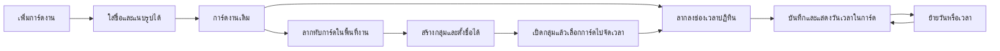

# Kemtit — ข้อกำหนดการ์ดงาน ปฏิทิน และกลุ่มการ์ด

วันที่: 9 ตุลาคม 2026

สถานะ: เพิ่มในแผนรุ่นแรกตามคำขอผู้ใช้ เป็นข้อกำหนดสำหรับออกแบบและพัฒนา ยังไม่ได้เปลี่ยนแอปหรือทดสอบ usability ของโฟลว์นี้

เป็นส่วนหนึ่งของ [แผน UX/UI หลัก หัวข้อ 6.2 และระยะ 2](2026-10-09-life-planning-ux-delivery-plan.md) ใช้สัญญา Drag & Drop ในหัวข้อ 6.1 ร่วมกัน ตัวเลือกตั้งต้นด้านล่างใช้ทำ mockup และปรับจากผลทดสอบได้

เงื่อนไขจากผู้ใช้: ออกแบบหน้าตาและองค์ประกอบของ Kemtit ขึ้นเอง ห้ามคัดลอกหน้าจอหรือ asset จากภาพอ้างอิง ใช้ภาพเพื่อวิเคราะห์โจทย์การใช้งานเท่านั้น รายละเอียดเพิ่มเติมจากภาพชุด B อยู่หัวข้อ 6.3 ของแผนหลัก โดย F1–F7 ยังเป็นข้อกำหนดเดิมครบ

## 1. ขอบเขตทั้ง 7 ข้อ

| ID | คำขอ | ผลที่ต้องส่งมอบ |
| --- | --- | --- |
| F1 | สร้างการ์ดสำหรับ Task | ฟอร์มสั้น มีชื่อเป็นข้อมูลจำเป็น แสดง Task เดิมเป็นการ์ด ใช้ ID เดียวกับ Today/Plan/Tasks |
| F2 | ลากการ์ดลงปฏิทิน | ลากจากพื้นที่การ์ดลงช่องวัน/เวลา เห็นตำแหน่งและระยะเวลาก่อนปล่อย มีปุ่มจัดเวลาทำงานเดียวกัน |
| F3 | บันทึกและอัปเดตวันเวลาในการ์ด | วางลงช่องเวลาแล้วบันทึกวัน เวลาเริ่ม และเวลาจบ; ย้ายแล้วการ์ด รายละเอียด และปฏิทินตรงกันหลังบันทึกและ reload; การกำหนดเฉพาะวันเป็นคำสั่งแยกที่ผู้ใช้เลือกเอง |
| F4 | รูปแรกเป็น cover ไม่มีรูปใช้ title | อัปโหลดรูปได้ ภาพแรกตามลำดับที่บันทึกเป็นปก ไม่มีรูปใช้ชื่อเด่น และชื่อยังมองเห็นแม้มีรูป |
| F5 | มือถือ tablet/iPad และ desktop | ทุกความสามารถหลักทำได้ด้วยวิธีป้อนข้อมูลของอุปกรณ์ ปรับ layout ตามพื้นที่ ไม่ย่อ desktop ทั้งหน้า |
| F6 | ลากการ์ดเข้าหากันสร้างกลุ่มแบบ iPhone | ลากทับเป้าหมายในพื้นที่การ์ดจนเห็น preview แล้วปล่อย สร้างกลุ่มทันที เปลี่ยนชื่อและย้อนกลับได้ |
| F7 | Research และใช้ง่าย | ใช้คู่มือผลิตภัณฑ์/แนวทาง accessibility ร่วมกับ usability test ของ Kemtit เป็นเกณฑ์ตรวจรับ |

## 2. พื้นที่ทำงานและลำดับการใช้

- เพิ่มมุมมองการ์ดใน Tasks และถาดการ์ดใน Calendar ใช้ Task ชุดเดิม ไม่เพิ่มเมนูหลักใหม่
- Desktop: ถาดงาน/กลุ่มทางซ้าย ปฏิทินทางขวา รายละเอียดเปิดเมื่อเลือกการ์ด แถบเครื่องมือมีค้นหา ตัวกรอง และเพิ่มงานเท่าที่จำเป็น
- ถาด Calendar เริ่มด้วยงานยังไม่จัดเวลา เปลี่ยนดูทั้งหมดหรือเปิดกลุ่มได้ งานที่จัดเวลาแล้วออกจากตัวกรองนี้ แต่ยังอยู่ใน Tasks/กลุ่มและปฏิทิน
- การ์ดปกติ: cover ถ้ามี → ชื่องาน → วัน/ช่วงเวลาที่จัดไว้ → ป้ายกลุ่มแบบย่อ; กำหนดส่งมีป้ายแยก ไม่ใช้ช่องเดียวกับวันตั้งใจทำ
- ช่องเวลาสั้นใช้การ์ดแบบย่อ ชื่อและเวลาต้องอ่านได้ก่อนภาพ; thumbnail แสดงเมื่อมีพื้นที่ และเปิดรายละเอียดดูภาพเต็มได้
- เพิ่มงานใช้ฟอร์มหน้าเดียวหรือแผงเดียว ไม่มี wizard; รูป เวลา กลุ่ม และรายละเอียดเพิ่มภายหลังได้

เพิ่มเติมจากภาพชุด B ตามแผนหลักหัวข้อ 6.3:

- ตารางเวลาที่มีสเกลคงความสูง block ตามระยะเวลาจริง เปิดรูป/checklist ในแผงรายละเอียดโดยไม่ยืด block ให้ดูเหมือนจองนานขึ้น; รายการเรียงเวลาไม่มีสเกลสามารถขยายการ์ดในที่เดิมได้
- การลากไปยังช่องเวลามีในมุมมองตารางตาม F2 ทั้งจอใหญ่และมือถือ ส่วนรายการเรียงเวลาใช้ปุ่มจัดเวลา/ย้ายวัน ไม่มีการแปลงตำแหน่งแนวตั้งของรายการเป็นเวลาโดยเดา
- ลากด้วยจุดจับ แตะชื่อเพื่อรายละเอียด และแตะ checkbox เพื่อ completion ต้องเป็นพื้นที่โต้ตอบที่แยกกัน การขยายรายละเอียดไม่สร้าง write และเวลาผ่านไม่ทำให้ Task เสร็จเอง
- โฟลเดอร์ F6 เป็นกลุ่ม Task; checklist เป็น subtasks หรือ Habit ตามชนิดข้อมูล งานซ้ำยังไม่มี subtask completion ต่อ occurrence จึงไม่สื่อว่ามี checklist รีเซ็ตทุกวัน
- ตัวเลือกวัน/เดือน แผงแก้ไข และตัวกรองใช้วัน/มุมมอง/ขอบเขตเดียวกับปฏิทิน เมื่อปิดแผงคืน focus และตำแหน่งเดิม; ซ่อนรายการด้วย filter ไม่ทำให้ช่วงเวลาที่จองแล้วว่างในการตรวจ overlap

## 3. F1–F3: การ์ดและวันเวลาต้องเป็นข้อมูลชุดเดียวกัน

1. เพิ่มการ์ด: กรอกชื่อ → บันทึก → เห็นการ์ดพร้อมลากได้ ไม่ต้องตั้งเป้าหมายหรือวันเวลาก่อน
2. วางในมุมมองวัน/สัปดาห์: preview เช่น “จันทร์ 10:00–10:30” ก่อนปล่อย; ระยะเวลาใช้ค่าประมาณของงาน ถ้าไม่มีใช้ 30 นาทีโดยแสดงและแก้ได้
3. ปล่อยแล้วเห็นตำแหน่งใหม่พร้อม “กำลังบันทึก” และเปลี่ยนเป็น “บันทึกแล้ว” เมื่อ server ยืนยัน; การ์ดและรายละเอียดแสดงวันเวลาเดียวกับช่วงเวลานั้น พร้อมย้อนกลับ
4. ลากช่วงเวลาที่มีอยู่ไป 14:00: เปลี่ยนช่วงเดิม คงระยะเวลาและ Task ID ไม่สร้างงานหรือช่วงเวลาใหม่จากการย้าย
5. ลากไปอีกวัน: ปฏิทิน การ์ด และวันที่งาน/occurrence ต้องสอดคล้องตามสัญญา 6.1 ของแผนหลัก; deadline ไม่เปลี่ยน งานที่มีหลายช่วงต้องเห็นผลกระทบก่อนยืนยัน
6. มุมมองเดือนมีแต่วันที่: การ์ดที่ยังไม่มีเวลาเปิดตัวเลือกเวลาเล็ก ๆ ก่อนบันทึก ไม่เดาเวลาเป็น 00:00; การ์ดที่มีช่วงเดียวคงเวลาเดิมและแสดง preview ก่อนย้าย
7. มีตัวเลือก “กำหนดเฉพาะวัน” เฉพาะงาน/occurrence ที่ไม่มี active time block: บันทึกวันตามสัญญาวันเดิมโดยไม่สร้าง block และแสดง “ยังไม่จัดเวลา”; ปิดตัวเลือกเวลาก่อนยืนยันต้องไม่ทิ้งการเปลี่ยนข้อมูลครึ่งชุด งานที่มีเวลาย้ายวันโดยคงช่วงเดิม หากต้องการกลับเป็นไม่มีเวลาต้องเลือก “ยกเลิกช่วงเวลา” ในรายละเอียดและระบุช่วงที่จะยกเลิกก่อน ไม่ยกเลิก linked blocks จากการเลือกวันเงียบ ๆ
8. งานมีหลายช่วง: การ์ดสรุปช่วงถัดไปและจำนวนช่วง เปิดดูทั้งหมดได้ ลาก block บนปฏิทินระบุ block ที่เลือก; ลากการ์ดจากถาดที่มีเวลาอยู่แล้วให้เลือกย้ายช่วงที่มี หรือเพิ่มอีกช่วงอย่างชัดเจน ไม่สร้างซ้ำเงียบ ๆ
9. แก้วันเวลาจากรายละเอียดใช้กฎเดียวกับการลาก; “ยกเลิกช่วงเวลา” แยกจากลบงาน งาน รูป และสมาชิกกลุ่มยังอยู่

“วันเวลาอยู่ในการ์ด” หมายถึงผู้ใช้ดูและแก้ได้จากการ์ด โดยอ้างช่วงเวลาที่เชื่อมกับ Task/occurrence เดิม ไม่เพิ่มช่อง datetime ซ้ำที่ต้อง sync กันเอง เมื่อเปลี่ยนวันเวลาต้อง refresh ทุกมุมมองที่เกี่ยวข้องและ readback หลัง reload/เปิดอีกอุปกรณ์

ใช้ atomic operation เมื่อกระทบหลายระเบียน ตรวจ overlap, deadline, version และสิทธิ์ฝั่ง server; กำหนด timezone การวางและการแสดงให้ตรงระบบเดิม ทดสอบข้ามวัน/เดือน/ปี และกรณีเปลี่ยน timezone โดยไม่เลื่อนเวลาที่บันทึกเงียบ ๆ ตามความสามารถจริงของระบบ ไม่ถือว่าการเพิ่มการ์ดอนุมัติเปลี่ยนสัญญา timezone ทั้งระบบ

บันทึกเฉพาะ drop ที่สำเร็จ ไม่เขียนตอน hover/pointer move; Escape, pointer cancel หรือปล่อยนอกเป้าหมายยกเลิกได้ ใช้ operation ID ป้องกันซ้ำและ Undo ที่ตรวจ version/ownership ตามแผนหลัก กรณี response หายต้องตรวจผล operation เดิมก่อนส่งซ้ำ

## 4. F4: รูปภาพและภาพปก

- เลือกรูปจากไฟล์หรือคลังรูปของอุปกรณ์ได้ภายใต้ข้อจำกัด upload เดิม ทุกอุปกรณ์มีปุ่ม “เพิ่มรูป”; desktop มีพื้นที่วางไฟล์เป็นทางลัด
- นิยามภาพแรกเป็นรูปแรกในชุดภาพแนบที่บันทึกสำเร็จ เรียงตามลำดับที่ผู้ใช้เพิ่ม/เลือก ไม่ใช่ความเร็ว upload ต้องเก็บลำดับถาวรไว้ก่อนส่งไฟล์เพื่อให้ลองใหม่แล้วยังได้ตำแหน่งเดิม งานเก่าที่ไม่มีลำดับใช้ `created_at` แล้ว `id` เป็นลำดับตั้งต้นที่แน่นอน
- คำสั่งแนบรูปต้องจองลำดับพร้อมสถานะ pending/failed/succeeded ที่ server หรือกลไกถาวรเทียบเท่าก่อน upload; reload อ่านรูปที่สำเร็จและสถานะที่ค้างได้ ไฟล์ที่ browser ยังไม่ได้ส่งอาจต้องให้เลือกใหม่ แต่ retry ใช้ตำแหน่งและ operation เดิม รายการจองไม่ถือเป็นภาพแนบสำเร็จและต้องยกเลิก/เก็บกวาดได้
- cover ใช้รูปแรกในลำดับนั้น ชื่ออยู่ด้านล่างเสมอ; ไม่มีรูปซ่อนพื้นที่ภาพและแสดงชื่อเด่น ไม่ทิ้งกรอบภาพว่างขนาดใหญ่
- ระหว่าง upload แสดง preview พร้อมสถานะยังไม่บันทึก แยกจาก cover ที่ยืนยันแล้ว; รูปล้มเหลวยังไม่ถือเป็นภาพแนบ แจ้งให้ลองใหม่หรือเอาออก ถ้ารูปลำดับแรกไม่สำเร็จใช้รูปแรกของชุดที่บันทึกสำเร็จ และใช้ title fallback เมื่อไม่มีรูปที่สำเร็จ เมื่อ retry รูปก่อนหน้าสำเร็จ cover กลับมาตามลำดับเดิม ผลหลังจบต้องเหมือนกันไม่ว่าไฟล์ใดเสร็จก่อน
- แสดง progress/ข้อผิดพลาดรายรูป งานที่บันทึกแล้วต้องยังใช้ได้แม้รูปบางไฟล์ล้มเหลว ระบุรูปที่ยังไม่บันทึก และ retry ไม่สร้าง Task หรือไฟล์แนบซ้ำ
- เอารูปแรกออกแล้วรูปถัดไปเป็น cover เหลือศูนย์ใช้ชื่อ; การเรียงรูปใหม่เพื่อเลือกปกเป็นทางเลือกภายหลัง ไม่จำเป็นต่อโฟลว์หลัก
- ใช้ thumbnail ตามขนาดการ์ด จองพื้นที่ขณะโหลดและโหลดภาพนอกจอภายหลัง; การครอปปกเป็นเพียงการแสดงผล ไม่แก้ต้นฉบับ
- รูปโหลดไม่ได้/URL หมดอายุยังมีชื่อและคำสั่งงานครบ รูปตกแต่งไม่ประกาศชื่อซ้ำ และปุ่มเปิดรูปมีชื่อที่โปรแกรมอ่านหน้าจอเข้าใจ
- ก่อน release ต้องตรวจชนิด/ขนาด/จำนวนไฟล์ที่อนุญาตและบอกผู้ใช้ก่อนเลือก ตรวจซ้ำฝั่ง server, ownership/Storage RLS, signed URL และการจัดการไฟล์ค้างหลัง failure
- รูปจาก iPhone เช่น HEIC ต้องมีเส้นทางรองรับที่ทดสอบจริง หรือแจ้งชนิดไฟล์ที่ใช้ได้อย่างชัดเจน ไม่ปล่อยให้เลือกแล้วหายเงียบ ๆ
- ต้องตรวจและเปิด feature flag ในสภาพแวดล้อมที่จะส่งมอบก่อนนับ F4 ผ่าน; การ fallback อย่างเดียวขณะ upload ถูกปิดไม่ถือว่าส่งมอบความสามารถอัปโหลดแล้ว

## 5. F6: กลุ่มการ์ดแบบโฟลเดอร์

- กลุ่มเป็นโฟลเดอร์จัดการ์ด คง Task ID ของทุกใบ ไม่รวมเนื้อหาเป็นงานเดียว และไม่เปลี่ยน Project/Goal ของสมาชิก
- เสนอรุ่นแรกกลุ่มชั้นเดียว งานหนึ่งใบอยู่ได้หนึ่งกลุ่ม; งานซ้ำอยู่กลุ่มระดับ Task ส่วนแต่ละครั้งยังมีวันเวลา/สถานะของตัวเอง จัดกลุ่มจากพื้นที่งาน ไม่ใช้การลาก occurrence บนปฏิทินเปลี่ยนทั้งชุด
- ลาก A ไปกลาง B → แสดงกรอบและข้อความ “รวมเป็นกลุ่ม” เมื่อค้างตรงเป้าหมาย → ปล่อย → สร้างกลุ่ม A+B ทันที ชื่อเริ่มต้น “กลุ่มใหม่” แก้ในที่เดิมได้ ไม่บังคับ modal ตั้งชื่อก่อนสร้าง
- ทดลองเวลาค้างบนเป้าหมายประมาณ 500ms เพื่อแยกการลากผ่าน ต้องปรับจากผลทดสอบจริง และตรึงเป้าหมายไม่ให้การ์ดหนีตำแหน่งระหว่างรอ
- ลากการ์ดเข้าโฟลเดอร์เพื่อเพิ่มสมาชิก เปิดเพื่อดูงาน ลากออกพื้นที่งานหรือกด “นำออกจากกลุ่ม” ได้ ย้ายระหว่างกลุ่มต้องนำออก/เพิ่มเข้าแบบ atomic ไม่ให้หายหรืออยู่สองกลุ่มจาก partial failure
- กลุ่มแสดงชื่อ จำนวนงาน และภาพย่อสมาชิก เช่น ไม่เกิน 4 ใบ; สมาชิกไม่มีรูปใช้ข้อความย่อ เปิดแล้วเห็นชื่อเต็ม วันและเวลาของทุกใบ
- กลุ่มเหลือสมาชิกหนึ่งใบยังอยู่เพื่อป้องกัน layout เปลี่ยนระหว่างจัดงาน; เอาสมาชิกสุดท้ายออกลบเฉพาะกลุ่มว่าง “ยุบกลุ่ม” คืนการ์ดทั้งหมดโดยไม่ลบงาน รูป หรือเวลา
- การสร้าง/เปลี่ยนชื่อ/ย้ายสมาชิก/ยุบกลุ่มมีผลบันทึกและ Undo ที่ตรวจ version/ownership; กลุ่มกับสมาชิกเริ่มต้นต้องบันทึกพร้อมกัน ไม่ทิ้งกลุ่มครึ่งชุดเมื่อเครือข่ายขัดข้อง
- งานที่มีเวลาและ deadline ต่างกันยังคงค่าเดิม กลุ่มอาจสรุปกำหนดถัดไปโดยมีป้ายชัดเจน ไม่กำหนดวันเดียวให้สมาชิกทั้งหมด
- **ลากทับรายการบนปฏิทินไม่สร้างกลุ่ม:** ปฏิทินใช้จัดเวลาและแจ้ง overlap ตามกฎเดิม รวมกลุ่มในพื้นที่การ์ดหรือเมนู “ย้ายเข้ากลุ่ม” แล้วแสดงป้ายกลุ่มบนรายการปฏิทิน
- การลากทั้งกลุ่มลงปฏิทินเพื่อจองทุกสมาชิกพร้อมกันเป็นขอบเขตภายหลัง รุ่นแรกแจ้งให้เปิดกลุ่มและเลือกงานจัดเวลาทีละใบ การนำการ์ดไปจัดเวลาไม่เอาออกจากกลุ่ม
- ยังไม่เพิ่มการเรียงการ์ดทั่วไปแบบอิสระจากการลากผ่านขอบ; ลำดับสมาชิกต้องคงที่หลัง reload และถ้าจะให้ผู้ใช้เรียงเองต้องออกแบบลำดับถาวร/กฎ filter เพิ่มตามแผนหลัก

กฎเมื่อการ์ดต้นทางหรือปลายทางอยู่ในกลุ่มแล้ว (preview ต้องระบุชื่อกลุ่มและงานที่ย้าย):

| ต้นทาง → ปลายทางในพื้นที่การ์ด | ผลเมื่อปล่อย |
| --- | --- |
| การ์ดไม่มี/มีกลุ่ม → การ์ดที่ยังไม่มีกลุ่ม | สร้างกลุ่มใหม่จากสองใบเท่านั้น ถ้าต้นทางมีกลุ่มเดิมให้นำเฉพาะใบที่จับออกจากกลุ่มเดิมแบบ atomic |
| การ์ด → สมาชิกของกลุ่มอื่น หรือโฟลเดอร์กลุ่มอื่น | เพิ่ม/ย้ายเฉพาะการ์ดที่จับเข้ากลุ่มปลายทาง ไม่สร้างกลุ่มซ้อนและไม่ย้ายสมาชิกอื่นตาม |
| การ์ด → ตัวเอง สมาชิกกลุ่มเดียวกัน หรือโฟลเดอร์เดิม | ไม่เปลี่ยนข้อมูล ไม่สร้างสมาชิกซ้ำ; แสดงว่าอยู่กลุ่มนี้แล้ว |
| โฟลเดอร์ → การ์ด โฟลเดอร์อื่น หรือปฏิทิน | ไม่รับ drop ในรุ่นแรก อธิบายให้เปิดกลุ่มแล้วเลือกการ์ด ไม่รวมทั้งโฟลเดอร์หรือจองเวลารวม |

การย้ายที่ทำให้กลุ่มต้นทางว่างใช้กฎลบเฉพาะกลุ่มว่างข้างต้น และ Undo ต้องคืนทั้งกลุ่มกับสมาชิกใน operation เดียว

## 6. F5: โฟลว์บนแต่ละอุปกรณ์

| พื้นที่/อุปกรณ์ | รูปแบบ | การโต้ตอบ |
| --- | --- | --- |
| Desktop | ถาดการ์ดข้างปฏิทินวัน/สัปดาห์ รายละเอียดเปิดข้างเมื่อมีพื้นที่ | mouse/trackpad, preview, เลื่อนขอบอัตโนมัติแบบควบคุมได้; ปุ่มและ keyboard |
| Tablet/iPad แนวนอน | ถาดงานกับปฏิทินคู่กันเมื่อชื่ออ่านได้ | touch/trackpad/keyboard; จุดจับแยกจากพื้นที่เลื่อน หมุนจอและ Split View ได้ |
| Tablet/iPad แนวตั้งหรือหน้าต่างแคบ | ปฏิทินวันหรือจำนวนวันที่อ่านได้ พร้อมถาดงานย่อ/ขยาย | เริ่มลากแล้วถาดย่อให้เห็นพื้นที่วางและรักษาการ์ดที่จับอยู่ |
| Mobile | ปฏิทินวัน + แถบเลือกวันที่ + ถาดการ์ดล่าง รายละเอียดหน้าเดียว | กดค้างจุดจับแล้วลาก ถาดย่อระหว่างลาก แสดงวัน/เวลาเหนือจุดสัมผัส; แตะ “จัดเวลา” แล้วเลือกวันเวลาได้ |

- เปลี่ยน layout ตามพื้นที่เนื้อหา ไม่อาศัยชื่ออุปกรณ์อย่างเดียว และไม่บังคับมือถือใช้ 7 คอลัมน์แคบ
- ลากด้วยนิ้วไม่ต้องใช้ hover/สองนิ้ว; การเลื่อนรายการไม่เริ่มลากโดยบังเอิญ ชื่อ ปุ่ม และรูปยังเปิดได้ตามปกติ
- มือถือรวมกลุ่มในถาดที่ขยายพอให้เห็นเป้าหมาย; pointer cancel/หมุนจอระหว่างลากคืนสถานะก่อนลากโดยไม่มี write
- มี “จัดเวลา”, “ย้ายไปวัน”, “สร้างกลุ่ม”, “ย้ายเข้ากลุ่ม” และ “นำออกจากกลุ่ม” ตามบริบท เพื่อทำทุก operation ด้วยการแตะโดยไม่ลาก และด้วย keyboard; keyboard fallback อย่างเดียวไม่ครอบคลุม tap-only
- ทดสอบ iPhone Safari, iPad Safari ทั้งนิ้ว/trackpad และ Android Chrome บนอุปกรณ์จริง รวม desktop Chrome/Safari/Edge/Firefox ในเวอร์ชันที่ระบุรองรับก่อน release
- ทดสอบ TH/EN ชื่อยาว 360/390/768/1024/1440px, 200% zoom, focus/screen reader, portrait/landscape และ iPad Split View; responsive emulation ไม่ใช่หลักฐานว่าอุปกรณ์จริงผ่าน
- “ทุกอุปกรณ์” เป็นเป้าหมายครอบคลุมประเภทอุปกรณ์ ไม่อ้างรองรับทุก browser/OS version โดยไม่มีผลทดสอบ ปุ่มทางเลือกต้องยังใช้ได้เมื่อ gesture มีข้อจำกัด

## 7. F7: Research และวิธีพิสูจน์ความง่าย

อ่านแหล่งหลักวันที่ 9 ต.ค. 2026:

| หลักฐาน | สิ่งที่นำมาใช้ | ขอบเขตของข้อสรุป |
| --- | --- | --- |
| [Sunsama — Timeboxing](https://help.sunsama.com/docs/usage-guides/timeboxing/) | มีทั้งลากงานลงเวลาและคำสั่งเพิ่มลงปฏิทิน กำหนดระยะเวลางานก่อนจัดเวลาได้ | เป็นตัวอย่าง interaction ไม่ใช่หลักฐานว่า Kemtit รองรับ calendar sync เท่าต้นทาง |
| [Apple — Move apps and create folders](https://support.apple.com/en-gb/108307) | ลากรายการทับกันสร้างโฟลเดอร์และเพิ่มสมาชิก เปลี่ยนชื่อได้ | การแยกพื้นที่รวมกลุ่มออกจากปฏิทินเป็นข้อเสนอเฉพาะ Kemtit |
| [W3C — Dragging Movements, WCAG 2.2](https://www.w3.org/WAI/WCAG22/Understanding/dragging-movements.html) | มี single-pointer alternative ที่ไม่ต้องลากสำหรับการลากที่ไม่จำเป็น โดยแยกจาก keyboard access | จึงต้องมีปุ่ม/เมนูแตะได้ทุก operation ไม่ได้แปลว่าผ่าน accessibility ทั้งระบบแล้ว |
| [Dribbble — Daily Planner](https://dribbble.com/tags/daily-planner) และภาพจากผู้ใช้ | ศึกษาลำดับภาพ ความหนาแน่น และภาพรวมวัน/สัปดาห์ | ภาพสวยไม่ยืนยัน usability, touch behavior หรือ persistence |

ทดสอบต้นแบบกับผู้ใช้ตัวแทนอย่างน้อย 5 คนในรอบนำร่อง ครอบคลุมผู้ใช้ใหม่/ประจำ พร้อมรอบ touch บนโทรศัพท์และ iPad ใช้โจทย์ผลลัพธ์ เช่น “เลื่อนงานนี้ไปพรุ่งนี้บ่ายสอง” โดยไม่สอนท่าลากก่อน

ชุดโจทย์: สร้างการ์ด → แนบรูป → วางเวลา → ย้ายวัน → รวมกลุ่ม → นำออก → ย้อนกลับ ให้ผู้ใช้บอกว่าวันตั้งใจทำ กำหนดส่ง และสมาชิกกลุ่มเปลี่ยนอะไรบ้าง

เกณฑ์นำร่องที่เสนอ: อย่างน้อย 4 ใน 5 คนทำแต่ละงานหลักได้เองด้วยการลากหรือปุ่ม บันทึกการค้นพบท่าลากแยกจากความสำเร็จรวม วัดเวลา การวางผิด การรวมกลุ่มโดยไม่ตั้งใจ และการย้อนกลับเทียบ baseline ปัญหาข้อมูลหาย/ซ้ำ/วันผิดต้องแก้ก่อนส่งมอบแม้คะแนนรวมดี ผลกลุ่มเล็กไม่ใช่สถิติประชากร และยังไม่ได้รันทดสอบนี้

## 8. ฐานเดิมและงานเทคนิคที่ต้องเพิ่ม

ตรวจแบบ read-only โดย advisor ผ่าน GitNexus และ source; commit ของ index ตรง checkout แต่มีไฟล์ใหม่ที่ยังไม่ index ผล grouping จาก graph ไม่เพียงพอจึงตรวจ schema/source เพิ่ม ไม่มีการแก้ฟังก์ชันในรอบแผนนี้

- `src/components/domain/TaskRow.tsx`, `TaskPhotos.tsx`: มีรายการงานและรูปย่อ/จำนวนแนบ ต้องเพิ่มการ์ดแบบ cover และสถานะการลาก ไม่ถือว่ามี card mode แล้ว
- `src/core/tasks/queries.ts`: query รูปใช้ `id,path` ไม่มีสัญญาลำดับ cover; `supabase/migrations/20260906120000_photos.sql` มี `task_photos.created_at` แต่ไม่มีลำดับเลือกไฟล์ ต้องกำหนดลำดับถาวรและ compatibility ของรูปเก่าก่อนพัฒนา
- `src/core/photos/queries.ts`: มี signed URLs ใช้โครงสร้างรูปเดิมต่อได้; `src/lib/flags.ts` เปิด upload เมื่อ `NEXT_PUBLIC_FLAG_UPLOADS` เป็น `1` ต้องตรวจค่าของ environment และเส้นทาง upload จริง ไม่อนุมานสถานะ production จากค่า default
- `src/core/tasks/actions.ts`, `src/core/planning/actions.ts`: มี task/occurrence reschedule และ create/update time block แต่ version, overlap และ linked-block protections มีไม่เท่ากันทุก action ต้องตรวจช่องว่างตามหัวข้อ 6.1 ของแผนหลัก; idempotency/Undo สำหรับการลากยังเป็นงานที่ต้องเพิ่มตาม action
- `src/components/domain/CalendarWeek.tsx`: ปัจจุบันแสดงรายการ/ลิงก์ ยังต้องเพิ่มพื้นที่รับ drop และ feedback
- `src/components/domain/TaskList.tsx` มีการจัดกลุ่มแสดงผลตามสถานะ ซึ่งไม่ใช่กลุ่มที่ผู้ใช้สร้าง; task ใน `src/types/database.ts` มี goal/project แต่ไม่มีความสัมพันธ์กลุ่มแบบนี้ในส่วนที่ตรวจ และ subtasks เป็นรายละเอียดงาน ไม่ใช้แทนโฟลเดอร์
- กลุ่มต้องมีข้อมูลชื่อ/เจ้าของ/สมาชิก/ลำดับคงที่/version และ mutation แบบ atomic/idempotent; เลือก migration ที่เพิ่มโดยไม่ทำลายของเดิม เช่น group + membership หรือแบบเทียบเท่าหลังตรวจ schema จริง ไม่ถือว่ามีตาราง/API เหล่านี้แล้ว
- ตรวจ ownership/RLS ทุกงานในกลุ่มและทุกภาพ ห้ามสร้างกลุ่มหรือย้ายสมาชิกข้ามผู้ใช้; ไม่เปลี่ยนสิทธิ์งานเพียงเพราะจัดกลุ่ม
- ต้องทำ impact ก่อนแก้และ detect_changes ก่อน commit; ความเสี่ยง CRITICAL ของ reschedule ที่บันทึกในแผนหลักยังต้องตรวจใหม่ก่อน implementation เอกสารนี้ไม่ใช่ clearance

## 9. ลำดับพัฒนาและเกณฑ์ตรวจรับ

ระยะ 0 ของแผนหลักทำ mockup ก่อนตาม batch: การ์ดไม่มีรูป/มีรูป, ถาดกับปฏิทิน, ลากและ preview, กลุ่มยุบ/เปิด, mobile/tablet/desktop, วางไม่ได้/บันทึกล้มเหลว/Undo จากนั้นพัฒนาเป็นชุดย่อยภายในระยะ 2:

| ชุด | งาน | ผ่านเมื่อ |
| --- | --- | --- |
| 2A | การ์ด Task + upload/cover + ถาดงาน | F1/F4 ผ่าน ชื่ออ่านได้ รูปแรกแน่นอน โหลดใหม่/เปิดอีกอุปกรณ์ตรงกัน และ uploads เปิดใช้งานจริงในสภาพแวดล้อมทดสอบ |
| 2B | วาง/ย้ายวันเวลา + ปุ่มทางเลือก | F2/F3 ผ่าน งานและ block ไม่ซ้ำ การ์ด/รายละเอียดตรงกัน ไม่มีวันที่เปลี่ยนครึ่งชุด; resize และ top 3 ตาม 6.1 ใช้ mutation/Undo ที่ปลอดภัย |
| 2C | กลุ่มแบบโฟลเดอร์ | F6 ผ่าน สร้าง/ย้าย/แยก/ยุบ/Undo ได้ งาน รูป วันเวลา และ Project/Goal คงเดิม |
| 2D | ตรวจรวมอุปกรณ์และ usability | F5/F7 ผ่านตาม matrix ที่ระบุ มีผลอุปกรณ์จริงและผู้ใช้ต้นแบบ แก้ปัญหาสำคัญก่อน release |

ข้อทดสอบสำคัญ:

1. สร้างงานครั้งเดียวด้วยชื่อไทยยาว ทั้งมีรูป/ไม่มีรูป; เมื่อรูปทั้งหมดสำเร็จ ภาพแรกตามลำดับที่เลือกเป็นปกแม้อัปโหลดช้ากว่า ระหว่าง pending/failure/reload ใช้รูปแรกที่สำเร็จพร้อมสถานะค้างตามข้อ 4; retry ไม่เปลี่ยนลำดับ เอาปกออกแล้วรูปถัดไปเป็นปก URL เสียยังใช้ชื่อและเปิดงานได้
2. ลากจันทร์ 10:00–10:30 แล้วเลื่อนไปอังคาร 14:00–14:30 การ์ด รายละเอียด และ reload ตรงกัน ช่วงเดิมไม่ค้าง deadline ไม่เปลี่ยน
3. มุมมองเดือน งานหลายช่วง งานซ้ำ และวันข้ามเดือน/ปี ไม่สร้างเที่ยงคืนเอง ไม่ย้ายผิด occurrence และไม่รวมครั้งที่วันชนกันทิ้ง
4. A+B ได้กลุ่มเดียว Task ID เดิมทั้งคู่ เพิ่ม C/นำ A ออก/ย้ายกลุ่ม/ยุบกลุ่มได้ ทดสอบครบกฎปลายทางในข้อ 5 รวมมีกลุ่มเดิม/กลุ่มเดียวกัน/ทั้งโฟลเดอร์ ลำดับและสมาชิกคงอยู่หลัง reload รูป วันเวลา และงานไม่หาย
5. ลากผ่านการ์ดไม่รวมกลุ่มเอง ลากทับ block ในปฏิทินใช้กฎเวลา กลุ่มทั้งใบวางลงเวลาไม่ได้และมีคำอธิบาย; cancel ไม่มี write
6. ทดสอบไฟล์ไม่รองรับ/ใหญ่เกิน/สิทธิ์ผิด/upload fail, overlap, locked, deadline conflict, concurrent edits, double drop, lost response/retry และ Undo ไม่เขียนทับงานใหม่
7. ตรวจทุก operation ด้วย mouse/touch/keyboard/tap-only ทั้งไทยและอังกฤษ รวม focus/ประกาศสถานะ iPad Split View และหมุนจอขณะลาก
8. อ่านกลับจาก server/อีกอุปกรณ์ยืนยันวันเวลา รูป สมาชิก และสถานะ ไม่พอเพียงตรวจ optimistic UI; ผลผ่านต้องผูกกับ build/environment/device ที่ใช้จริง

เกณฑ์ร่วมกับ U1–U5/U7: preview วันเวลาตรงกับวันที่เลือก ขยายรายละเอียดไม่เปลี่ยน duration ปุ่มไม่เริ่ม drag โดยบังเอิญ ตัวกรองไม่ข้าม overlap และ card design/ข้อความ/asset ต้องเป็นงานของ Kemtit ที่ตรวจที่มาได้ตามข้อกำหนดห้ามคัดลอก

ไม่ระบุวันเสร็จจนตรวจ schema, mockup และ effort ครบ การส่งมอบรุ่นแรกต้องรวมทั้ง 7 ข้อ ไม่ลดกลุ่ม/รูป/มือถือเหลือเพียงข้อความว่าไว้ภายหลัง ส่วน group scheduling, nested groups, global manual ordering และ custom cover picker แยกจากคำขอนี้
